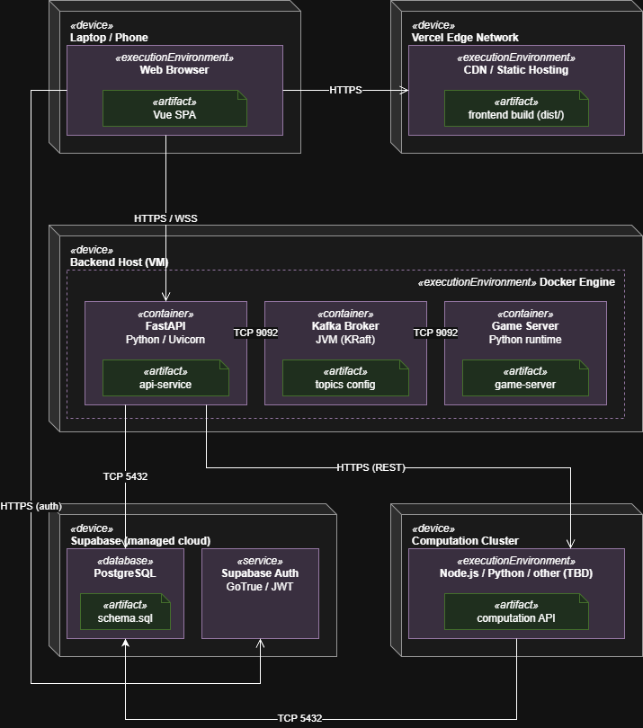
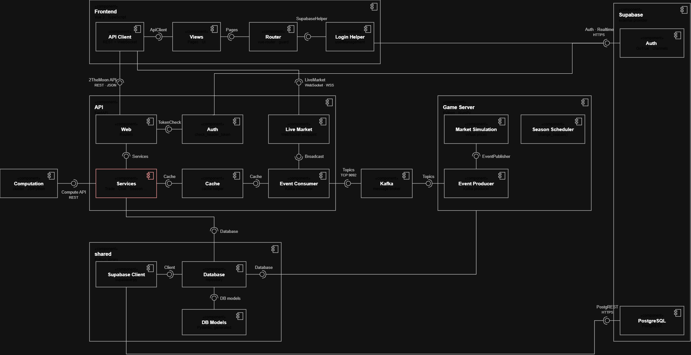

# 2TheMoon — Software Architecture Document

<!--
HOW TO USE THIS TEMPLATE
- Copy this file into the docs/ folder of your repository, next to SRS.md.
- Replace every [placeholder] in square brackets. Comments like this one are guidance: they
  are invisible on GitHub, and you may delete them once a section is done.
- Keep every heading and its number. Sections marked "Lecture 7" or later stay as they are
  until that lecture. If a section does not apply, write "Not applicable" and one sentence why.
- Every section you write names its author: in the "Author" line below its heading, or in
  the Author column of a table.
- Put every diagram into docs/diagrams/, the image together with its source file.
- Structure after the RUP template "Software Architecture Document":
  https://cin.ufpe.br/~if682/RUP/webtmpl/templates/a_and_d/rup_sad.htm
-->

| Team | Version | Last change |
| ---- | ------- | ----------- |
| 2TheMoon | 0.1 | 26.10.26 |

The Git history of this file is the revision history.

## Table of contents

1. [Introduction](#1-introduction)
2. [Architectural representation](#2-architectural-representation)
3. [Architectural goals and constraints](#3-architectural-goals-and-constraints)
4. [Use-case view](#4-use-case-view)
5. [Logical view](#5-logical-view)
6. [Process view](#6-process-view)
7. [Deployment view](#7-deployment-view)
8. [Implementation view](#8-implementation-view)
9. [Data view](#9-data-view)
10. [Size and performance](#10-size-and-performance)
11. [Quality](#11-quality)

## 1 Introduction

### 1.1 Purpose

*Author: [first name]*

<!-- One paragraph: what this document describes and who reads it — your team, the developer
     who takes the project over, and the lecturer as investor. -->

This document describes the architecture of [project name]: the parts the application is made
of, how they are connected, and where they run. […]

### 1.2 Scope

*Author: [first name]*

<!-- One or two sentences: which software this document covers, e.g., the whole application
     with frontend, backend, and database. The functional scope is in SRS 1.2 — link it. -->

[…] The functional scope is described in [SRS 1.2](SRS.md#12-scope).

### 1.3 Definitions, acronyms and abbreviations

*Author: [first name]*

<!-- Terms of the domain are in the SRS and in your domain model. Add only the technical terms
     a reader of this document needs. -->

| Term | Meaning |
| ---- | ------- |
| SAD | Software Architecture Document |
| SRS | Software Requirements Specification |
| UCR | Use-case realization |
| [term] | [meaning] |

### 1.4 References

*Author: [first name]*

| Title | Link |
| ----- | ---- |
| SRS | [SRS.md](SRS.md) |
| Domain model | [domain_model.md](domain_model.md) |
| Repository | [link] |
| Board | [link to your GitHub Projects board] |

### 1.5 Overview

Section 2 names the views this document uses. Sections 3 to 11 describe the architecture view
by view, following the RUP template.

## 2 Architectural representation

*Author: [first name]*

<!-- Which views you use and which diagram shows each. The table is prefilled with the views of
     Lecture 6 — adjust it if you add or drop a view. Later lectures add your architectural
     style and your architecture decisions here. -->

| View | Question it answers | Diagram | Section |
| ---- | ------------------- | ------- | ------- |
| Use-case view | What does the system do, and for whom? | Use case diagram, use-case realizations | 4 |
| Logical view | Which classes, and how are they linked? | Class diagrams | 5 |
| Process view | What runs at the same time? | Short description | 6 |
| Deployment view | What runs where, and how is it connected? | Deployment diagram | 7 |
| Implementation view | Which parts is the code made of? | Component diagram, package diagram | 8 |

## 3 Architectural goals and constraints

<!-- Lecture 7. The requirements and constraints that shape your architecture: quality goals
     such as availability or security, and constraints such as your stack (SRS 3.6), your team
     size, or your schedule. Leave this section as it is until then. -->

*Follows with Lecture 7.*

## 4 Use-case view

*Author: [first name]*

<!-- The use cases that matter most for your architecture — usually the ones you realized in
     Task 4. Link your use case diagram instead of copying it. -->

The use case diagram of the whole application is in [SRS 2.2](SRS.md#22-use-case-diagram). The
use cases most important for the architecture are: […]

### 4.1 Use-case realizations

<!-- One row per realization from Task 4. No new diagrams: link the files. -->

| Use case | Realization | Author |
| -------- | ----------- | ------ |
| [UC-02 Book a room](use_cases/UC-02_[name].md) | [UCR-02](use_case_realizations/UCR-02_[name].md) | [first name] |

## 5 Logical view

### 5.1 Overview

*Author: [first name]*

<!-- Link your domain model from Task 5. If you have a package diagram, put it here: the
     packages of your code and their dependencies, without cycles. -->

The domain model is in [domain_model.md](domain_model.md). […]

### 5.2 Architecturally significant design packages

<!-- Optional for now. Link the design classes of your realizations (UCR section 2.5) or describe
     your most important packages in one sentence each. -->

[…]

## 6 Process view

*Author: [first name]*

<!-- Optional for now. One or two sentences: which processes run, e.g., the frontend in the
     browser, the backend, the database — and anything that runs in the background, such as a
     scheduled job. -->

[…]

## 7 Deployment view

*Author: Justus*

<!-- One UML deployment diagram: nodes (devices, execution environments), the artifacts that
     run on them, and the communication paths with their protocol. Draw the setup you plan for
     your final demo — or the one you use today, and say which. -->

| Node                     | What runs there                                                                                                     | Connected to                                                                                                                                  |
|--------------------------|---------------------------------------------------------------------------------------------------------------------|-----------------------------------------------------------------------------------------------------------------------------------------------|
| Laptop / Phone           | Web browser running the Vue SPA                                                                                     | Vercel: HTTPS · Backend host (FastAPI): HTTPS / WSS · Supabase Auth: HTTPS                                                                    |
| Vercel Edge Network      | CDN / static hosting with the frontend build (dist/)                                                                | Browser: HTTPS                                                                                                                                |
| Backend Host (VM)        | Docker Engine with three containers: FastAPI (api-service), Kafka broker (topics config), Game Server (game-server) | Browser: HTTPS / WSS · Supabase PostgreSQL: TCP 5432 · Computation Cluster: HTTPS (REST) · internally FastAPI ↔ Kafka ↔ Game Server: TCP 9092 |
| Supabase (managed cloud) | PostgreSQL (schema.sql) and Supabase Auth (GoTrue / JWT)                                                            | Browser: HTTPS (auth) · FastAPI: TCP 5432 · Computation Cluster: TCP 5432                                                                     |
| Computation Cluster      | Computation API on Node.js / Python / other (TBD) (deployed on with Docker)                                       | FastAPI: HTTPS (REST) · Supabase PostgreSQL: TCP 5432                                                                                         |

## 8 Implementation view

### 8.1 Overview

*Author: Justus*

<!-- One UML component diagram of the whole application: frontend, backend, database, external
     services, and the interfaces between them (ball = provides, socket = requires). Two to five
     components inside the backend are a good size. -->

| Component                | Responsibility                                                     | Classes (Task 5)                                                                      |
|--------------------------|--------------------------------------------------------------------|---------------------------------------------------------------------------------------|
| Views                    | Shows the pages and UI; takes user input                           | PortfolioPage, TradePage, StocksOverviewPage, ChatWindow, SeasonIndicator             |
| Router                   | Resolves URLs to pages, guards protected routes                    | – (vue-router config)                                                                 |
| Login Helper             | Login, session check                                               | - (technical, no use case)                                                            |
| API Client               | Calls the REST API, receives live market data via WebSocket        | – (technical, no use case)                                                            |
| Web                      | Receives HTTP requests, validates input, returns uniform responses | AssetRouter, PortfolioController, TradeController, ChatRouter, SeasonRouter           |
| Auth                     | Checks the token of every request                                  | – (technical, no use case)                                                            |
| Services                 | Business logic: trading, portfolio, chat, seasons, market data     | AssetService, PortfolioService, TradeService, ChatService, ChatFilter, SeasonService  |
| Cache                    | Keeps current prices in memory for fast reads                      | – (technical, no use case)                                                            |
| Live Market              | Pushes price updates to clients over WebSocket                     | – (technical, no use case)                                                            |
| Event Consumer           | Reads market events from Kafka, fills cache, triggers broadcast    | – (technical, no use case)                                                            |
| Market Simulation        | Calculates virtual prices from random effects and trades           | – (no actor, runs on its own)                                                         |
| Season Scheduler         | Ends seasons on time and starts the next one                       | SeasonScheduler                                                                       |
| Event Producer           | Publishes price events to Kafka                                    | – (technical, no use case)                                                            |
| Database (shared)        | Executes all DB requests, maps errors to DatabaseError             | Database                                                                              |
| DB Models (shared)       | Data structures of the domain entities                             | TradingAsset, UserProfile, UserHolding, TradingRecord, Portfolio, Season, ChatMessage |
| Supabase Client (shared) | Connection to Supabase (public/secret client)                      | – (supabase-py)                                                                       |
### 8.2 Layers

<!-- Lectures 8 and 9. The layers of your application and the rules between them. Leave this
     section as it is until then. -->

*Follows with Lectures 8 and 9.*

## 9 Data view

*Author: Max*

<!-- Optional for now. Later: your database schema or ER model, derived from your domain model. -->

*Follows later.*

## 10 Size and performance

<!-- Lecture 7. The numbers that shape your architecture, e.g., expected users and data, and
     your performance requirements from SRS 3.4. Leave this section as it is until then. -->

*Follows with Lecture 7.*

## 11 Quality

<!-- Lectures 7 to 9. How your architecture supports the qualities you need: availability,
     security, maintainability, … Leave this section as it is until then. -->

*Follows with Lectures 7 to 9.*