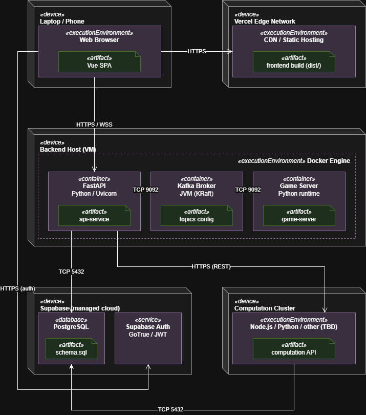
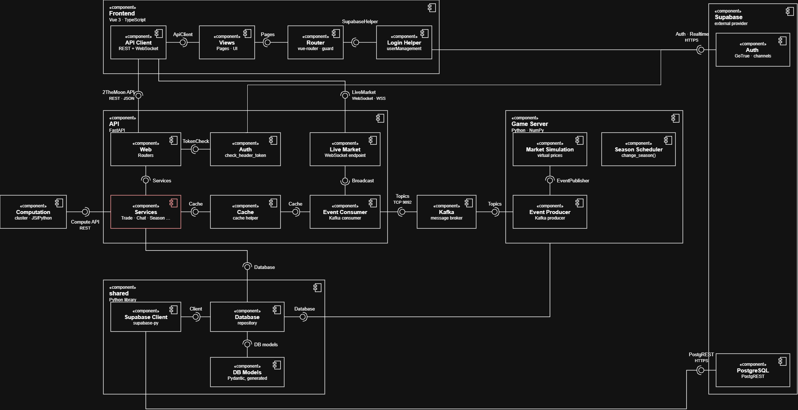

# 2TheMoon — Software Architecture Document

<!--
HOW TO USE THIS TEMPLATE
- Copy this file into the docs/ folder of your repository, next to SRS.md.
- Replace every [placeholder] in square brackets. Comments like this one are guidance: they
  are invisible on GitHub, and you may delete them once a section is done.
- Keep every heading and its number. Sections marked "Lecture 7" or later stay as they are
  until that lecture. If a section does not apply, write "Not applicable" and one sentence why.
- Every section you write names its author: in the "Author" line below its heading, or in
  the Author column of a table.
- Put every diagram into docs/diagrams/, the image together with its source file.
- Structure after the RUP template "Software Architecture Document":
  https://cin.ufpe.br/~if682/RUP/webtmpl/templates/a_and_d/rup_sad.htm
-->

| Team     | Version | Last change |
|----------|---------|-------------|
| 2TheMoon | 0.1     | 26.10.26    |

The Git history of this file is the revision history.

## Table of contents

1. [Introduction](#1-introduction)
2. [Architectural representation](#2-architectural-representation)
3. [Architectural goals and constraints](#3-architectural-goals-and-constraints)
4. [Use-case view](#4-use-case-view)
5. [Logical view](#5-logical-view)
6. [Process view](#6-process-view)
7. [Deployment view](#7-deployment-view)
8. [Implementation view](#8-implementation-view)
9. [Data view](#9-data-view)
10. [Size and performance](#10-size-and-performance)
11. [Quality](#11-quality)

## 1 Introduction

### 1.1 Purpose

*Author: Sebastian*

<!-- One paragraph: what this document describes and who reads it — your team, the developer
     who takes the project over, and the lecturer as investor. -->

This document describes the architecture of the trading game *2TheMoon*: the parts the application is made
of, how they are connected, and where they run. It serves as a foundation to the developers as we design the system in
the elaboration phase of the project development. Furthermore, other stakeholders such as the lecturer can use it as a
reference document in the future.

### 1.2 Scope

*Author: Sebastian*

<!-- One or two sentences: which software this document covers, e.g., the whole application
     with frontend, backend, and database. The functional scope is in SRS 1.2 — link it. -->

This SAD describes the structure of the entirety of the 2TheMoon web app consisting of a frontend, API, database and a
separate message broker. The functional scope is described in [SRS 1.2](SRS.md#12-scope).

### 1.3 Definitions, acronyms and abbreviations

*Author: Sebastian*

<!-- Terms of the domain are in the SRS and in your domain model. Add only the technical terms
     a reader of this document needs. -->

| Term | Meaning                             |
|------|-------------------------------------|
| SAD  | Software Architecture Document      |
| SRS  | Software Requirements Specification |
| UCR  | Use-case realization                |
| 2TM  | 2TheMoon                            |

### 1.4 References

*Author: Sebastian*

| Title        | Link                                                  |
|--------------|-------------------------------------------------------|
| SRS          | [SRS.md](SRS.md)                                      |
| Domain model | [domain_model.md](domain_model.md)                    |
| Repository   | [GitHub](https://github.com/justusbruegmann/2TheMoon) |
| Board        | [YouTrack](https://2themoon.youtrack.cloud/agiles)    |

### 1.5 Overview

Section 2 names the views this document uses. Sections 3 to 11 describe the architecture view
by view, following the RUP template.

## 2 Architectural representation

*Author: Sebastian*

<!-- Which views you use and which diagram shows each. The table is prefilled with the views of
     Lecture 6 — adjust it if you add or drop a view. Later lectures add your architectural
     style and your architecture decisions here. -->

| View                | Question it answers                       | Diagram                                 | Section |
|---------------------|-------------------------------------------|-----------------------------------------|---------|
| Use-case view       | What does the system do, and for whom?    | Use case diagram, use-case realizations | 4       |
| Logical view        | Which classes, and how are they linked?   | Class diagrams                          | 5       |
| Process view        | What runs at the same time?               | Short description                       | 6       |
| Deployment view     | What runs where, and how is it connected? | Deployment diagram                      | 7       |
| Implementation view | Which parts is the code made of?          | Component diagram, package diagram      | 8       |

## 3 Architectural goals and constraints

<!--
TASK 7 — paste this over section 3 of your SAD.md, which still says "Follows with Lecture 7".
- Replace every [placeholder] in square brackets. Comments like this one are invisible on GitHub;
  delete them once a part is done.
- One scenario per member: copy the QS block once per scenario and put your name on it.
- Worked examples for every part: Task 7, and Lecture 7, slides 14 to 25.
-->

Section 3 lists the requirements that shape our architecture: our quality goals as scenarios,
rated by business value and technical risk, and the constraints we have to design around. How the
architecture reaches each scenario follows in section 11.

### 3.1 Quality goals

*Author: [Mika]*

<!-- The utility tree as a table. One row per scenario. Value and risk: H, M or L.
     The short form: stimulus → response measure. -->

| ID    | Quality    | Refinement   | Scenario, short                           | Value | Risk | Author       |
|-------|------------|--------------|-------------------------------------------|:-----:|:----:|--------------|
| QS-01 | Relibility | Atomic trades (NFR-R-02)   | Trade data → every Trade changed 3 tables |  H  | L  | Justus       |
| QS-02 | Data integrity | Trade log (NFR-S-02)         | User confirms a buy or sell → exactly one immutable log entry with executed price, in all trades |   H   |  M   | Sebastian |
| QS-03 | Performance  | Initial page load (NFR-P-05) | Initial page request → Page load time < 3 s at the 95th percentile  of request         |  M  | M  | Max |

No scenario is (H, H). QS-02 comes first: its value is high, and it shapes the architecture the most, because the trade log needs a lot of storage while the Supabase free tier only offers 500 MB.

#### QS-01 Postgres Transaction

<!-- Start from the sentence in your SRS (3.2 to 3.5) and name every part.
     The artifact is a component from your component diagram (section 8). -->

| QS-01 Postgres Transaction | *Author: Justus* · Refines NFR-R-02                                                                                            |
|----------------------------|--------------------------------------------------------------------------------------------------------------------------------|
| Source                     | User                                                                                                                           |
| Stimulus                   | creates a Trade and a failure occurs before the DB transaction is committed                                                    |
| Artifact                   | API, Shared, Database                                                                                                          |
| Environment                | Normal operation                                                                                                               |
| Response                   | All 3 table writes run in one DB transaction. On commit success, return 201. On failure, roll back and return an error.        |
| Response measure           | In 100% of tests, either all 3 tables contain the trade changes or none do, and 201 is only returned after a successful commit |

Business value M: So the user cant have a trade that did not go through. Technical risk M: If the transaction fails, the
user will have to retry the operation.

#### QS-02 Trade History

| QS-02 Trade History | *Author: Sebastian* · Refines NFR-S-02                                                                                                                     |
|---------------------|------------------------------------------------------------------------------------------------------------------------------------------------------------|
| Source              | User                                                                                                                                                       |
| Stimulus            | Confirms a buy or sell decision                                                                                                                            |
| Artifact            | Database table trade_history / API endpoint /trade_history                                                                                                 |
| Environment         | Normal operation                                                                                                                                           |
| Response            | The system writes one immutable trade log into the trade_log table. It contains (amongst others) the user, asset, quantity, executed price, and timestamp. |
| Response measure    | 100 % of confirmed trades produce exactly one trade log entry with the executed price attached                                                             |

Business value H: An incomplete trade log makes the portfolio charts in the frontend unusable, because it renders
misleading performances.
Technical risk M: Removing the trade_log table is a simple change in the database; but to be able to reconstruct a
history of portfolio values, we would need to keep track of fine-grained price developments, which would immensely
inflate the required storage space in the database.

#### QS-03 Fast Initial Page Load

| QS-03 Fast Initial Page Load     | *Author: Maximilian* · Refines NFR-P-05 |
|------------------|-------------------------------------------|
| Source           | User opening the website                                      |
| Stimulus         | Opens the page and requests the initial HTML and JS bundle            |
| Artifact         | Frontend Server        |
| Environment      | Normal operation, standard internet connection 25 Mbit/s          |
| Response         | The frontend server delivers the HTML and JS and the browser renders the start page            |
| Response measure | In 95% of the time the page loads in under 3 seconds  |

Business value H: The first load is the user's first impression of 2TheMoon, a slow start drives novice traders away before they reach the trading simulation.
Technical risk M: A Vue.js SPA bundle grows with every feature (charting, chat, portfolio views). The target is achievable with code splitting, lazy-loaded routes and gzip/brotli compression, but it needs continuous bundle-size monitoring

### 3.2 Constraints

*Author: [Mika]*

<!-- At least three. Kinds: technical, organizational, economic, legal.
     Your stack is in SRS 3.6 — link it instead of copying it. -->

| ID   | Kind           | Constraint                                               | What it means for our architecture |
|------|----------------|----------------------------------------------------------|------------------------------------|
| C-01 | Technical      | Frontend in TypeScript/Vue, backend in Python/FastAPI, database PostgreSQL                                                     | Two languages, so no code can be shared between frontend and backend. Backend components share code only through the Python package "shared".                                                                                                                                                                              |
| C-02 | Technical      | Login and database run on Supabase (Supabase Auth, managed PostgreSQL)                                                                                                                      | We don't build an authentication of our own. The database is outside our server, so every access goes over the network. Availability and latency also depend on Supabase.                                                                                                     |
| C-03 | Technical      | A message broker (Redis Streams) carries the market events, and nobody in the team has experience with it                                                                         | The broker stays hidden behind Event Producer and Event Consumer, so we can replace it. We keep the number of streams small and plan time to learn it.                                                                                                                                                                    |
| C-04 | Organizational | 4 members, about 4 h per week each, until the end of semester 4 (about 06. 2027), excluding the practical phase from 21.12.26 until 28.03.27.                                                                                                          | Few components, and no technology that we cannot operate ourselves. A new service is added only if its benefit clearly outweighs the effort.                                                                                                                                                                |
| C-05 | Economic       | No budget: frontend on Vercel (free tier), backend on the server of a team member, database on Supabase (free tier)                                                                         | All backend containers (API, broker, game server) run on one machine, with no redundancy and no automatic scaling. If the server fails, the backend fails.The Supabase free tier only offers 500 MB of storage, so the data of the pricing history can't take up too much space.                  |
| C-06 | Technical      | Frontend (Vercel) and backend (member's server) run on different hosts and domains                                                                                                          | The server must be reachable from the internet over HTTPS/WSS with a valid certificate, otherwise the browser blocks the connection from the HTTPS page. The backend needs a CORS configuration for the Vercel domain.                    |
| C-07 | Legal          | We store user name, password, and the stock holdings of an account, but no real money and no bank connection. The DSGVO still applies to personal data.                                      | Passwords are stored only by Supabase Auth, never in our own tables. Each user sees only their own portfolio. We store only the data we need, and users must be able to delete their account.                                                                                                                              |

## 4 Use-case view

*Author: Mika*

<!-- The use cases that matter most for your architecture — usually the ones you realized in
     Task 4. Link your use case diagram instead of copying it. -->

The use case diagram of the whole application is in [SRS 2.2](SRS.md#22-use-case-diagram).

The use cases most important for the architecture are:

- [UC-01 Analyze Portfolio](use_cases/UC-01_Analyze_Portfolio.md)
- [UC-05 Trade Assets](use_cases/UC-05_Trade_Assets.md)
- [UC-06 Analyze the Market](use_cases/UC-06_Analyze_the_Market.md)

### 4.1 Use-case realizations

<!-- One row per realization from Task 4. No new diagrams: link the files. -->

| Use case                                                                          | Realization                                                          | Author    |
|-----------------------------------------------------------------------------------|----------------------------------------------------------------------|-----------|
| [UC-01 Analyze Portfolio](use_cases/UC-01_Analyze_Portfolio.md)                   | [UCR-01](use_case_realizations/UCR-01-Analyze_Portfolio.md)          | Justus    |
| [UC-02 Compare Player Performance](use_cases/UC-02_Compare_Player_Performance.md) | [UCR-02](use_case_realizations/UCR-02-Compare-Player-Performance.md) | Mika      |
| [UC-03 Use Global Chat](use_cases/UC-03_Use_Global_Chat.md)                       | [UCR-03](use_case_realizations/UCR-03_Use_Global_Chat.md)            | Max       |
| [UC-04 Compete in Seasons](use_cases/UC-04_Compete_in_Seasons.md)                 | [UCR-04](use_case_realizations/UCR-04_Compete_in_Seasons.md)         | Max       |
| [UC-05 Trade Assets](use_cases/UC-05_Trade_Assets.md)                             | [UCR-05](use_case_realizations/UCR-05-Trade_Assets.md)               | Justus    |
| [UC-06 Analyze the Market](use_cases/UC-06_Analyze_the_Market.md)                 | [UCR-06](use_case_realizations/UCR-06_Analyze_the_Market.md)         | Sebastian |

## 5 Logical view

### 5.1 Overview

*Author: Mika*

<!-- Link your domain model from Task 5. If you have a package diagram, put it here: the
     packages of your code and their dependencies, without cycles. -->

The domain model is in [domain_model.md](domain_model.md).

### 5.2 Architecturally significant design packages

<!-- Optional for now. Link the design classes of your realizations (UCR section 2.5) or describe
     your most important packages in one sentence each. -->

Design-class diagrams:

- [UCR-01 Analyze Portfolio](diagrams/UCR-01_classes.png)
- [UCR-05 Trade Assets](diagrams/UCR-05_classes.png)
- [UCR-06 Analyze the Market](diagrams/UCR-06_classes.png)

## 6 Process view

*Author: [first name]*

<!-- Optional for now. One or two sentences: which processes run, e.g., the frontend in the
     browser, the backend, the database — and anything that runs in the background, such as a
     scheduled job. -->

[…]

## 7 Deployment view

*Author: Justus*

<!-- One UML deployment diagram: nodes (devices, execution environments), the artifacts that
     run on them, and the communication paths with their protocol. Draw the setup you plan for
     your final demo — or the one you use today, and say which. -->

This is the deployment diagram for our final demo setup. The frontend is deployed on Vercel, the backend on a VM with
Docker Engine, and the database is hosted by Supabase. The computation cluster is a separate service that can be scaled
independently.

| Node                     | What runs there                                                                                                     | Connected to                                                                                                                                  |
|--------------------------|---------------------------------------------------------------------------------------------------------------------|-----------------------------------------------------------------------------------------------------------------------------------------------|
| Laptop / Phone           | Web browser running the Vue SPA                                                                                     | Vercel: HTTPS · Backend host (FastAPI): HTTPS / WSS · Supabase Auth: HTTPS                                                                    |
| Vercel Edge Network      | CDN / static hosting with the frontend build (dist/)                                                                | Browser: HTTPS                                                                                                                                |
| Backend Host (VM)        | Docker Engine with three containers: FastAPI (api-service), Kafka broker (topics config), Game Server (game-server) | Browser: HTTPS / WSS · Supabase PostgreSQL: TCP 5432 · Computation Cluster: HTTPS (REST) · internally FastAPI ↔ Kafka ↔ Game Server: TCP 9092 |
| Supabase (managed cloud) | PostgreSQL (schema.sql) and Supabase Auth (GoTrue / JWT)                                                            | Browser: HTTPS (auth) · FastAPI: TCP 5432 · Computation Cluster: TCP 5432                                                                     |
| Computation Cluster      | Computation API on Node.js / Python / other (TBD) (deployed on with Docker)                                         | FastAPI: HTTPS (REST) · Supabase PostgreSQL: TCP 5432                                                                                         |

## 8 Implementation view

### 8.1 Overview3

*Author: Justus*

<!-- One UML component diagram of the whole application: frontend, backend, database, external
     services, and the interfaces between them (ball = provides, socket = requires). Two to five
     components inside the backend are a good size. -->

We have an semi-microservice architecture with a frontend, a api layer, a game server and a database. Furthermore we
have a computation cluster which will be used to perform heavy calculations for portfolio value and price analysis.
The shared part can be easily used by the other components because it's a python package.

| Component                | Responsibility                                                     | Classes (Task 5)                                                                      |
|--------------------------|--------------------------------------------------------------------|---------------------------------------------------------------------------------------|
| Views                    | Shows the pages and UI; takes user input                           | PortfolioPage, TradePage, StocksOverviewPage, ChatWindow, SeasonIndicator             |
| Router                   | Resolves URLs to pages, guards protected routes                    | – (vue-router config)                                                                 |
| Login Helper             | Login, session check                                               | - (technical, no use case)                                                            |
| API Client               | Calls the REST API, receives live market data via WebSocket        | – (technical, no use case)                                                            |
| Web                      | Receives HTTP requests, validates input, returns uniform responses | AssetRouter, PortfolioController, TradeController, ChatRouter, SeasonRouter           |
| Auth                     | Checks the token of every request                                  | – (technical, no use case)                                                            |
| Services                 | Business logic: trading, portfolio, chat, seasons, market data     | AssetService, PortfolioService, TradeService, ChatService, ChatFilter, SeasonService  |
| Cache                    | Keeps current prices in memory for fast reads                      | – (technical, no use case)                                                            |
| Live Market              | Pushes price updates to clients over WebSocket                     | – (technical, no use case)                                                            |
| Event Consumer           | Reads market events from Kafka, fills cache, triggers broadcast    | – (technical, no use case)                                                            |
| Market Simulation        | Calculates virtual prices from random effects and trades           | – (no actor, runs on its own)                                                         |
| Season Scheduler         | Ends seasons on time and starts the next one                       | SeasonScheduler                                                                       |
| Event Producer           | Publishes price events to Kafka                                    | – (technical, no use case)                                                            |
| Database (shared)        | Executes all DB requests, maps errors to DatabaseError             | Database                                                                              |
| DB Models (shared)       | Data structures of the domain entities                             | TradingAsset, UserProfile, UserHolding, TradingRecord, Portfolio, Season, ChatMessage |
| Supabase Client (shared) | Connection to Supabase (public/secret client)                      | – (supabase-py)                                                                       |

### 8.2 Layers

<!-- Lectures 8 and 9. The layers of your application and the rules between them. Leave this
     section as it is until then. -->

*Follows with Lectures 8 and 9.*

## 9 Data view

*Author: Max*

<!-- Optional for now. Later: your database schema or ER model, derived from your domain model. -->

*Follows later.*

## 10 Size and performance

<!-- Lecture 7. The numbers that shape your architecture, e.g., expected users and data, and
     your performance requirements from SRS 3.4. Leave this section as it is until then. -->

*Follows with Lecture 7.*

## 11 Quality

<!-- Lectures 7 to 9. How your architecture supports the qualities you need: availability,
     security, maintainability, … Leave this section as it is until then. -->

*Follows with Lectures 7 to 9.*