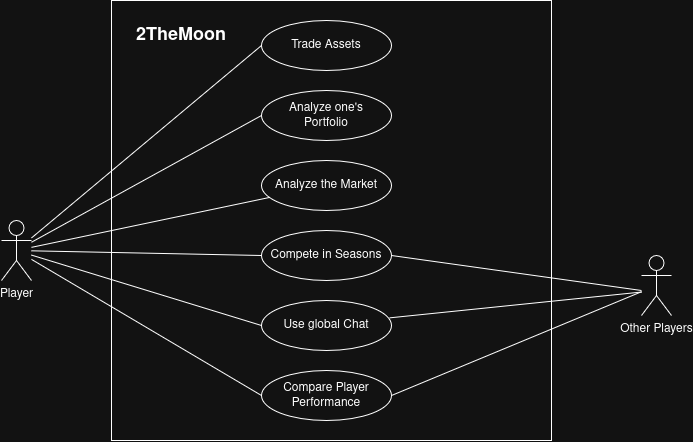

# 2TheMoon — Software Requirements Specification

<!--
HOW TO USE THIS TEMPLATE
- ✓ Copy the whole docs/ folder into your repository.
- Replace every [placeholder] in square brackets. Comments like this one are guidance: they
  are invisible on GitHub, and you may delete them once a section is done.
- Keep every heading and its number. If a section does not apply, write
  "Not applicable" and one sentence why.
- Every section you write names its author: in the "Author" line below its heading, or in
  the Author column of a table. Prefilled sections need no author.
- Structure after the RUP template "Software Requirements Specification":
  https://cin.ufpe.br/~if682/RUP/webtmpl/templates/req/rup_srs.htm
-->

| Team   | Version | Last change |
|--------|---------|-------------|
| Team 5 | 1.0     | 16.10.2026  |

The Git history of this file is the revision history.

## Table of contents

1. [Introduction](#1-introduction)
2. [Overall description](#2-overall-description)
3. [Specific requirements](#3-specific-requirements)
4. [Supporting information](#4-supporting-information)

## 1 Introduction

### 1.1 Purpose

*Author: Sebastian*

This document specifies the requirements of the stock market simulation and trading game **2TheMoon**.
It is to be used by the developers in Team 5 as a reference document during development,
by the lecturer as informational material and possibly other stakeholders in the future as systems documentation.

### 1.2 Scope

*Author: Sebastian*

<!-- What the software does and for whom, in two or three sentences.
     Then split explicitly into in scope and out of scope, each with a reason.
     Out of scope = your MoSCoW "won't have this time". Document later changes here. -->

| In scope                                   | Reason                                                          |
|--------------------------------------------|-----------------------------------------------------------------|
| Trading stocks                             | core functionality of the game                                  |
| Analyzing the market                       | core functionality of the game                                  |
| Comparing with other players (leaderboard) | keeps the players hooked on the game                            |
| Chatting with other players                | make the game feel more alive and interesting in the short-term |
| Season-system for game rounds              | gives the game long-term replayability                          |

| Out of scope                           | Reason                                                                                                               |
|----------------------------------------|----------------------------------------------------------------------------------------------------------------------|
| Trading with real money on real assets | not permissible as a DHBW project; legal requirements too high                                                       |
| Teaching how to trade                  | we are unqualified to provide financial guidance and do not want to be legally held accountable for potential losses |

### 1.3 Definitions, acronyms and abbreviations

*Author: Sebastian*

| Term | Meaning                                                        |
|------|----------------------------------------------------------------|
| SRS  | Software Requirements Specification                            |
| UC   | Use case                                                       |
| NFR  | Non-functional requirement (quality requirement or constraint) |
| US   | User Story                                                     |
| SME  | Subject Matter Expert                                          |

### 1.4 References

*Author: Sebastian*

| Title          | Link                                                              |
|----------------|-------------------------------------------------------------------|
| Blog           | [GitHub](https://github.com/justusbruegmann/2TheMoon/discussions) |
| Board          | [YouTrack](https://2themoon.youtrack.cloud/agiles/)               |
| Knowledge Base | [YouTrack](https://2themoon.youtrack.cloud/articles)              |

### 1.5 Overview

Section 2 describes the product as a whole: vision and use case diagram. Section 3 lists the
specific requirements: the use cases (3.1) and the quality requirements and constraints (3.2 to 3.12).

## 2 Overall description

### 2.1 Vision

*Author: Sebastian*

<!-- Your vision from Task 1, updated: the problem, the target group and the stakeholders,
     the value, and how you differ from alternatives. The investor should get it in two minutes. -->

**2TheMoon** is a massively multiplayer online real-time trading game based on a market simulation inspired by
the real world stock market.

Players manage virtual portfolios that all equally start out with a given starting value in each season. The goal is to
accumulate wealth through buying and selling stocks and crypto, while the trading patterns of other players affect the
market state and prices. Randomized global events carry big boons or disruptions to the market and can greatly alter the
standings on the global leaderboards.

The game is marketed at novices in the trading space that can explore the subject hands-on in a gamified, low-stakes
environment.

Competitors usually follow the real market with their trading games – 2TheMoon is unchained from the limitations and
boring patterns of reality and can potentially add differently themed settings and events for each new season (e.g.
Bottle cap trading in a Fallout setting).

### 2.2 Use case diagram

*Author: Sebastian*

<!-- One UML use case diagram for the whole application, at least five high-level use cases;
     login and registration do not count. Commit the source file next to the image. -->

### 2.3 Assumptions and dependencies

*Author: Sebastian*

<!-- Optional: what you assume (e.g., users have a DHBW account) and what you depend on
     (e.g., an external API). Delete the comment and write "None" if there are none. -->

The market simulation depends on Real-World trading data as an initial state (at least for the first season).
It will then be simulated independently of the live data.

## 3 Specific requirements

### 3.1 Functionality

<!-- One subsection per use case. The specification lives in its own file in use_cases/,
     created from UC-00_template.md. Here: name, author, one sentence, link.
     Task 3: at least one specified use case per team member (four entries with a link below).
     List every use case of your diagram; mark the ones not specified yet as "planned". -->

#### 3.1.1 UC-01 Analyze Portfolio

*Author: Justus* · An overview page shows the player their portfolio: The stock they own, its performance over time and
how much money they have to invest. · [Specification](use_cases/UC-01_Analyze_Portfolio.md)

#### 3.1.2 UC-02 Compare Player Performance

*Author: Mika* · A leaderboard page shows the portfolio performance of all players so that rivalries can make the game
more engaging. · [Specification](use_cases/UC-02_Compare_Player_Performance.md)

#### 3.1.3 UC-03 Use global Chat

*Author: Max* · A global chat enables players to communicate among each other as well as broadcast system-wide messages
to all users. · [Specification](use_cases/UC-03_Use_Global_Chat.md)

#### 3.1.4 UC-04 Compete in Seasons

*Author: Max* · The game runs in seasons after which the winners are crowned, progress is wiped, and all players start
anew in a new (possibly differently themed) market. · [Specification](use_cases/UC-04_Compete_in_Seasons.md)

#### 3.1.5 UC-05 Trade Assets

*Author: Justus* · Players can buy and sell assets (stocks or
crypto). · [Specification](use_cases/UC-05_Trade_Assets.md)

#### 3.1.6 UC-06 Analyze the Market

*Author: Sebastian* · [One sentence.] · [Specification](use_cases/UC-06_Analyze_the_Market.md)

<!-- QUALITY REQUIREMENTS (3.2 to 3.5)
     At least one per section. Each one: an ID, one sentence with "shall", a number you can
     test, and if possible stimulus, response and measure. IDs are unique in the whole SRS,
     including the special requirements of your use cases.
     Example: NFR-P-01 — When 50 users search at the same time, the app lists free slots
     within 1 s for 95 % of the requests. -->

### 3.2 Usability

| ID       | Requirement              | Author    |
|----------|--------------------------|-----------|
| NFR-U-01 | [measurable requirement] | Justus    |
| NFR-U-02 | [measurable requirement] | Mika      |
| NFR-U-03 | [measurable requirement] | Max       |
| NFR-U-04 | [measurable requirement] | Max       |
| NFR-U-05 | [measurable requirement] | Justus    |
| NFR-U-06 | [measurable requirement] | Sebastian |

### 3.3 Reliability

| ID       | Requirement              | Author    |
|----------|--------------------------|-----------|
| NFR-R-01 | [measurable requirement] | Justus    |
| NFR-R-02 | [measurable requirement] | Mika      |
| NFR-R-03 | [measurable requirement] | Max       |
| NFR-R-04 | [measurable requirement] | Max       |
| NFR-R-05 | [measurable requirement] | Justus    |
| NFR-R-06 | [measurable requirement] | Sebastian |

### 3.4 Performance

| ID       | Requirement              | Author    |
|----------|--------------------------|-----------|
| NFR-P-01 | [measurable requirement] | Justus    |
| NFR-P-02 | [measurable requirement] | Mika      |
| NFR-P-03 | [measurable requirement] | Max       |
| NFR-P-04 | [measurable requirement] | Max       |
| NFR-P-05 | [measurable requirement] | Justus    |
| NFR-P-06 | [measurable requirement] | Sebastian |

### 3.5 Supportability

| ID       | Requirement              | Author    |
|----------|--------------------------|-----------|
| NFR-S-01 | [measurable requirement] | Justus    |
| NFR-S-02 | [measurable requirement] | Mika      |
| NFR-S-03 | [measurable requirement] | Max       |
| NFR-S-04 | [measurable requirement] | Max       |
| NFR-S-05 | [measurable requirement] | Justus    |
| NFR-S-06 | [measurable requirement] | Sebastian |

### 3.6 Design constraints

*Author: [first name]*

<!-- Decisions that are fixed, not chosen per feature: your stack. -->

| ID    | Constraint                     |
|-------|--------------------------------|
| DC-01 | Frontend: TypeScript, VueJS    |
| DC-02 | Backend: Python, FastAPI       |
| DC-03 | Database: PostgreSQL, Supabase |

### 3.7 Online user documentation and help system requirements

Not applicable. [Reason, or replace with requirements.]

### 3.8 Purchased components

Not applicable. [Reason, or list them.]

### 3.9 Interfaces

*Author: [first name]*

#### 3.9.1 User interfaces

<!-- Link the mockups of your use cases, or describe the main screens in one line each. -->

[…]

#### 3.9.2 Hardware interfaces

Not applicable. [Reason.]

#### 3.9.3 Software interfaces

<!-- External services and APIs you use, e.g., an e-mail service. -->

[…]

#### 3.9.4 Communications interfaces

<!-- E.g., HTTPS between frontend and backend. -->

[…]

### 3.10 Licensing requirements

*Author: [first name]*

<!-- The license of your project, and of libraries that impose conditions. -->

[…]

### 3.11 Legal, copyright and other notices

*Author: [first name]*

<!-- E.g., data protection (GDPR) if you store personal data. -->

[…]

### 3.12 Applicable standards

*Author: [first name]*

<!-- E.g., WCAG 2.2 level AA, a coding standard. -->

[…]

## 4 Supporting information

<!-- Optional: appendices, glossary extensions, interview notes. -->

None.
