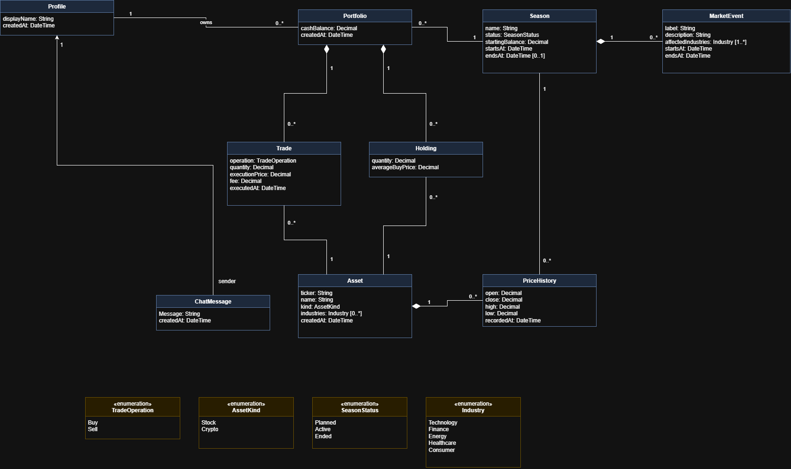

# Domain model
| Authors | [first names]             |
|---------|---------------------------|
| Team    | Justus, Sebastian and Max |

## Classes
| Class        | Meaning                                       |
|--------------|-----------------------------------------------|
| Profile      | User metadata                                 |
| Portfolio    | A portfolio for a user that is in a season    |
| Season       | A season in which a user can have a portfolio |
| MarketEvent  | A random market event for an season           |
| PriceHistory | The price of an stock in a Season             |
| Asset        | A financial asset in the market               |
| Holding      | A portfolio's Holding of an Asset             |
| Trade        | A portfolio's trade of an Asset               |
| ChatMessage  | A user's chat message                         |
