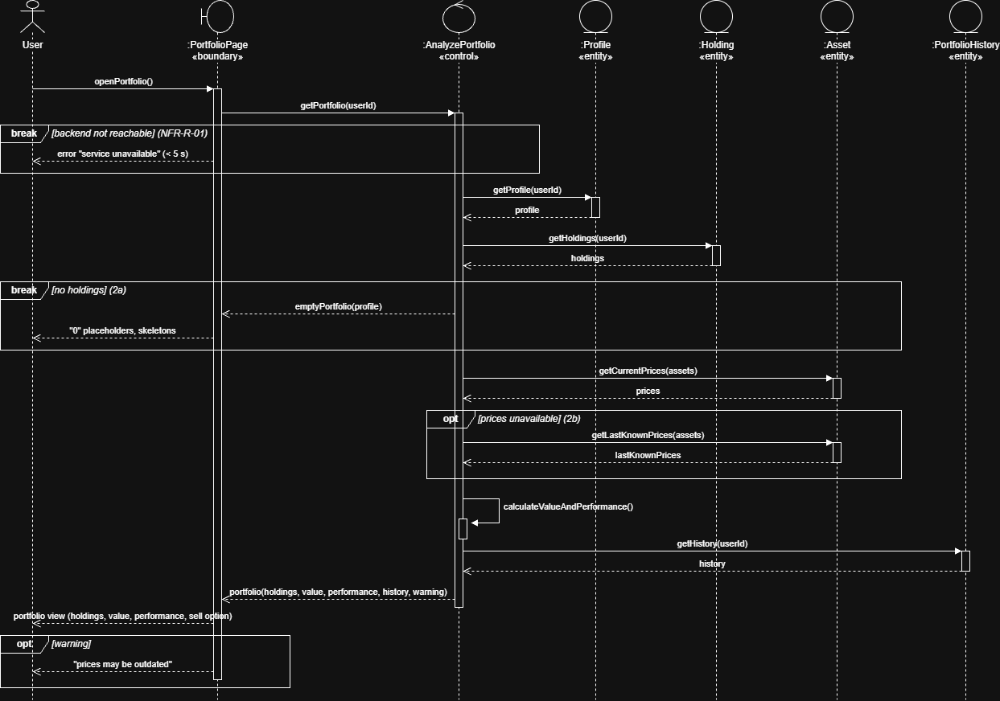
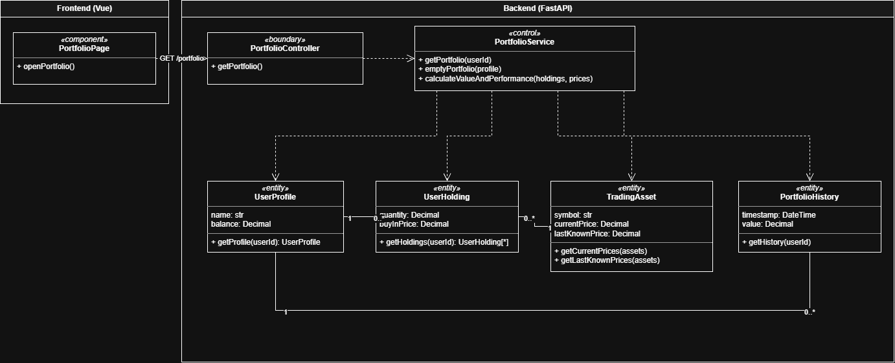
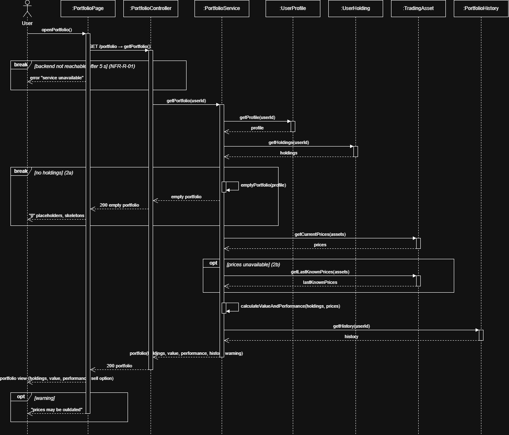

# UCR-01-Analyze_Portfolio — Use-Case Realization

| Author | Realizes |
| ------ | -------- |
| Justus | [UC-01-Analyze_Portfolio](../use_cases/UC-01_Analyze_Portfolio.md) |

## 1 Introduction
This document describes the realization of [UC-01 Analyze Portfolio](../use_cases/UC-01_Analyze_Portfolio.md).
It shows which objects work together, and in which order, when a logged-in user opens the portfolio page
to see his holdings with their current value and performance. The alternative flows "no holdings" (2a) and
"price data unavailable" (2b) are covered as fragments in the sequence diagram.

## 2 Flow of events — design

### 2.1 Participating objects

| Object               | Stereotype | Responsibility                                                                 |
|----------------------|------------|--------------------------------------------------------------------------------|
| :PortfolioPage       | «boundary» | Shows the user's portfolio (holdings, value, performance, history) and warnings |
| :AnalyzePortfolio    | «control»  | Collects profile, holdings, prices and history; calculates value and performance |
| :Profile             | «entity»   | The user's profile data, e.g. name and cash balance                            |
| :Holding             | «entity»   | One asset the user owns, with its quantity and buy-in price                    |
| :Asset               | «entity»   | A tradable asset with its current and last known price                         |
| :PortfolioHistory    | «entity»   | The portfolio's value over time  |

### 2.2 Sequence diagrams

### 2.3 Walkthrough

When the user opens the portfolio page the frontend tries to retrieve the data from the api.
From the NFR-R-01 we know that if the backend request takes more than 5s we need to show an error.

Then we try to get the profile and the holdings, if the user has no holdings we return an empty portfolio with "0" placeholder and skeletons.

Then we try to get the prices if their not available, we try to get the last known prices.
Then we calculate the portfolio value and performance.

At last we try to get the portfolio history.
If we did not get the current prices we show an warning.

### 2.4 State machine

Not applicable

### 2.5 Design classes

| Analysis object (2.1)          | Design class(es)                    |
| ------------------------------ | ----------------------------------- |
| :PortfolioPage «boundary»      | PortfolioPage, PortfolioController  |
| :AnalyzePortfolio «control»    | PortfolioService                    |
| :Profile «entity»              | UserProfile                         |
| :Holding «entity»              | UserHolding                         |
| :Asset «entity»                | TradingAsset                        |
| :PortfolioHistory «entity»     | PortfolioHistory                    |

## 3 Derived requirements

None