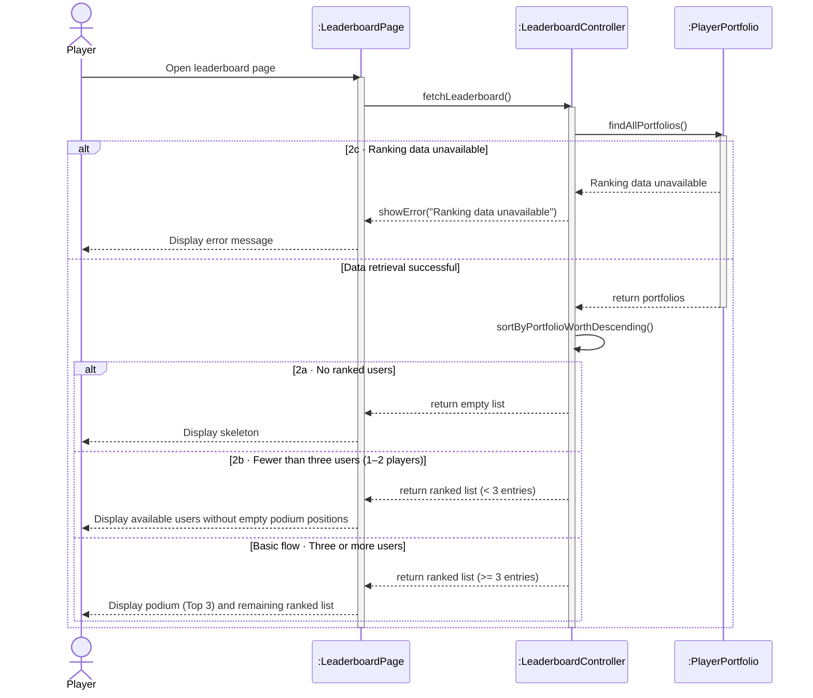
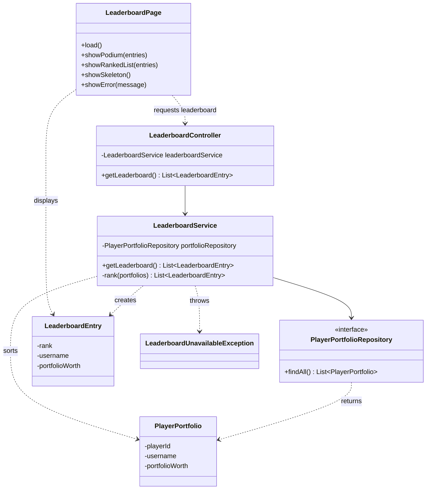
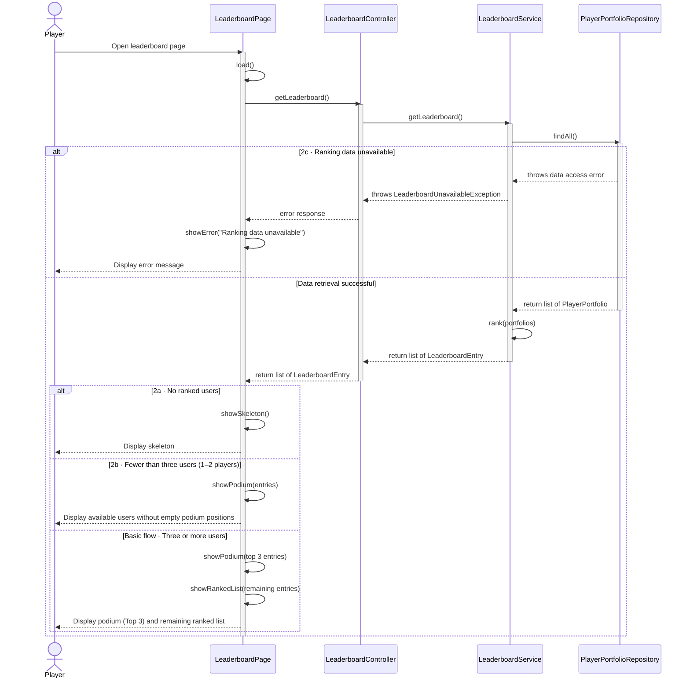

# UCR-02 Compare Player Performance — Use-Case Realization

| Author | Realizes |
| ------ | -------- |
| Mika | [UC-02 Compare Player Performance](../use_cases/UC-02_compare_player_performance.md) |

## 1 Introduction

This document describes the analysis level for the use case **UC-02 Compare Player Performance**. It covers the basic flow (displaying the podium and ranked list) as well as all alternative flows: missing players (2a), fewer than three players available (2b), and the error case when ranking data is unavailable (2c). Since this use case involves read-only access, no state changes occur within the system.

## 2 Flow of events — design

### 2.1 Participating objects

| Object | Stereotype | Responsibility |
| ------ | ---------- | -------------- |
| `:LeaderboardPage` | boundary | Provides the user interface for the leaderboard, handles player interactions, and displays the podium, ranked list, skeleton view, or error messages. |
| `:LeaderboardController` | control | Coordinates fetching portfolio data, performs sorting by portfolio worth, determines ranks, and controls data preparation for display. |
| `:PlayerPortfolio` | entity | Holds persistent data for player portfolios (e.g., player lookup/identification, username, and current portfolio worth). |

### 2.2 Sequence diagrams

### 2.3 Walkthrough

1. The player opens the leaderboard page, then the boundary component :LeaderboardPage forwards the request to the control object :LeaderboardController.
2. The :LeaderboardController requests all portfolio data from the entity object :PlayerPortfolio.
3. If an error occurs during data retrieval (step 2c), the controller returns an error message to :LeaderboardPage, which then displays an error message to the player.
4. If retrieval is successful, the controller sorts the portfolios in descending order by total worth and determines the rankings:

     - If no entries exist (step 2a), the controller signals an empty result and :LeaderboardPage renders a skeleton view.

     - If fewer than three entries exist (step 2b), the controller passes the available entries, and :LeaderboardPage displays only the available ranks without empty podium positions.

     - If three or more entries exist (basic flow), the top three players are displayed on the podium and all remaining players are shown in the list.

### 2.4 State machine

Not applicable

### 2.5 Design classes

The analysis objects from section 2.1 are mapped to the following design classes. The frontend is shown only as far as it matters for this use case (one page class). The backend follows a layered structure: controller (REST endpoint), service (business logic) and repository (data access).

| Analysis object (2.1) | Design class(es) |
| --------------------- | ---------------- |
| `:LeaderboardPage` «boundary» | `LeaderboardPage`, `LeaderboardController` |
| `:LeaderboardController` «control» | `LeaderboardService` |
| `:PlayerPortfolio` «entity» | `PlayerPortfolio`, `PlayerPortfolioRepository` |

`LeaderboardEntry` is an additional data class: it is the result of the ranking and carries rank, username and portfolio worth to the page. `LeaderboardUnavailableException` is thrown by the service if the ranking data cannot be retrieved (flow 2c).

#### 2.5.1 Class diagram

#### 2.5.2 Sequence diagram with design classes

## 3 Derived requirements

- **DR-02-01** — If two or more players have an identical portfolio worth, sorting in :LeaderboardController must use a unique secondary criterion (e.g., account creation date or alphabetically by username) to guarantee a deterministic ranking order.

- **DR-02-02** — Fetching portfolio data from :PlayerPortfolio must include a defined read timeout for a good transition into flow 2c (Ranking data unavailable) in the event of network failures.