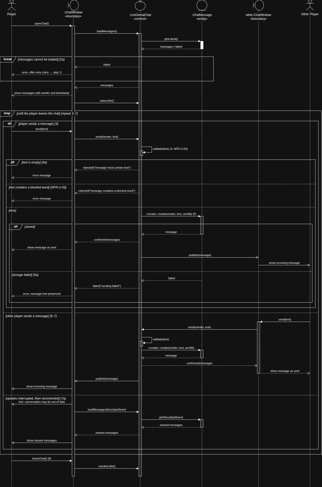
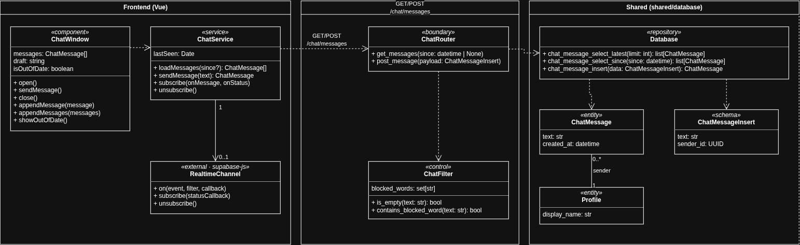
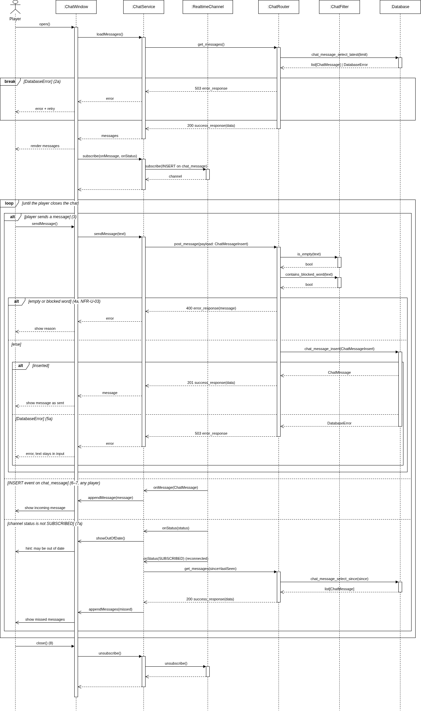

# UCR-03 Use Global Chat — Use-Case Realization

| Author | Realizes                                                    |
|--------|-------------------------------------------------------------|
| Max    | [UC-03 Use Global Chat](../use_cases/UC-03_Use_Global_Chat.md) |

## 1 Introduction

This document describes how [UC-03 Use Global Chat](../use_cases/UC-03_Use_Global_Chat.md) is realized: which
objects work together, and in which order, when a player opens the global chat, sends messages, receives messages of
other players, and leaves the chat. It covers the basic flow and all alternative flows (2a, 3a, 4a, 5a, 7a) as well as
the blocked-word filter of NFR-U-03. Broadcasting system-wide messages (SRS 3.1.3) and moderation are left out.

## 2 Flow of events — design

### 2.1 Participating objects

| Object           | Stereotype | Responsibility                                                                                   |
|------------------|------------|--------------------------------------------------------------------------------------------------|
| :ChatWindow      | «boundary» | Shows the messages with sender and timestamp, takes the text from the player, shows errors and hints |
| other:ChatWindow | «boundary» | The same chat window of another player; sends their messages and shows published ones             |
| :UseGlobalChat   | «control»  | Loads messages, validates and filters new ones, stores them, and publishes them to all chat windows |
| :ChatMessage     | «entity»   | One message in the global chat: sender, text, and the time it was sent                           |

### 2.2 Sequence diagrams

### 2.3 Walkthrough

When the player opens the chat (step 1), `:ChatWindow` asks `:UseGlobalChat` to load the messages, which reads the
latest `:ChatMessage` entries. If they cannot be loaded, the `break` fragment ends the use case with an error and the
offer to try again (2a). Otherwise the window shows the messages with sender and timestamp (step 2) and subscribes
to new ones.

The `loop` repeats steps 3–7 until the player leaves. If the player leaves without sending anything, the loop simply
runs zero times (3a). The outer `alt` separates three things that can happen while the chat is open:

- **The player sends a message** (steps 3–5). `:UseGlobalChat` validates the text. An empty text (4a) or a text with
  a blocked word (NFR-U-03) is rejected with a reason, and the player can edit it. A valid message is created as a
  `:ChatMessage`. If storing fails (5a), the player gets an error and the text stays in the input; nothing is
  published. If it is stored, the sender sees it as sent and `:UseGlobalChat` publishes it to the other chat windows.
- **Another player sends a message** (steps 6–7). The same validation and storage run for their message; then
  `:UseGlobalChat` publishes it to the player's `:ChatWindow`, which shows it.
- **Updates are interrupted** (7a). The window shows that the conversation may be out of date. After reconnection it
  loads all messages since the last one it has seen and shows them.

Finally the player leaves the chat (step 8) and the window unsubscribes.

### 2.4 State machine

Not applicable

### 2.5 Design classes

| Analysis object (2.1)         | Design class(es)                                                                                                                            |
|-------------------------------|---------------------------------------------------------------------------------------------------------------------------------------------|
| :ChatWindow «boundary»        | ChatWindow                                                                                     |
| other:ChatWindow «boundary»   | ChatWindow of the other player — the same class                                                                                              |
| :UseGlobalChat «control»      | ChatService, ChatRouter, ChatFilter, RealtimeChannel |
| :ChatMessage «entity»         | ChatMessage, ChatMessageInsert, Database |

Do not wonder, I switched to draw.io light mode...

Both versions of the sequence diagram stay in the repo, so a reader can see how the analysis objects became design
classes: [UCR-03_sequence.drawio](../diagrams/UCR-03_sequence.drawio) (analysis) and
[UCR-03_sequence_design.drawio](../diagrams/UCR-03_sequence_design.drawio) (design).

## 3 Derived requirements

- DR-03-01 — The empty check and the blocked-word filter run on the server before the message is stored; the
  blocked words are read from the configuration, matched case-insensitively and as whole words (NFR-U-03).
- DR-03-02 — Clients may read `chat_message` but not insert into it directly; new messages are
  only accepted through `POST /chat/messages`, so the filter cannot be bypassed.
- DR-03-03 — A message the sender receives both as the POST response and as a realtime event is shown only once
  (deduplicated by its id).
- DR-03-04 — After a reconnection the client loads all messages newer than the last one it has shown (7a).
