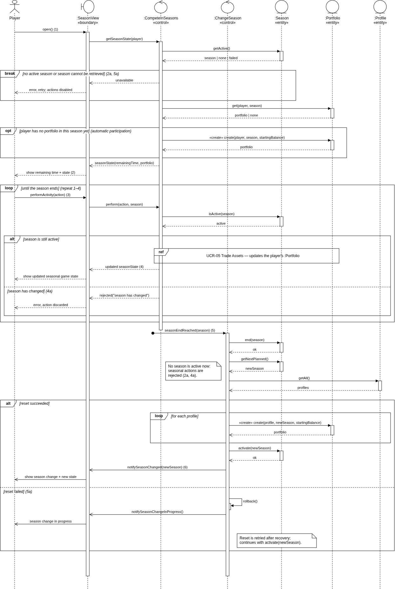
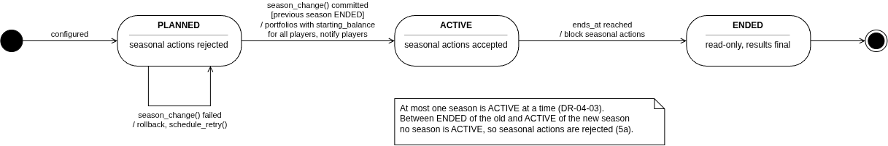
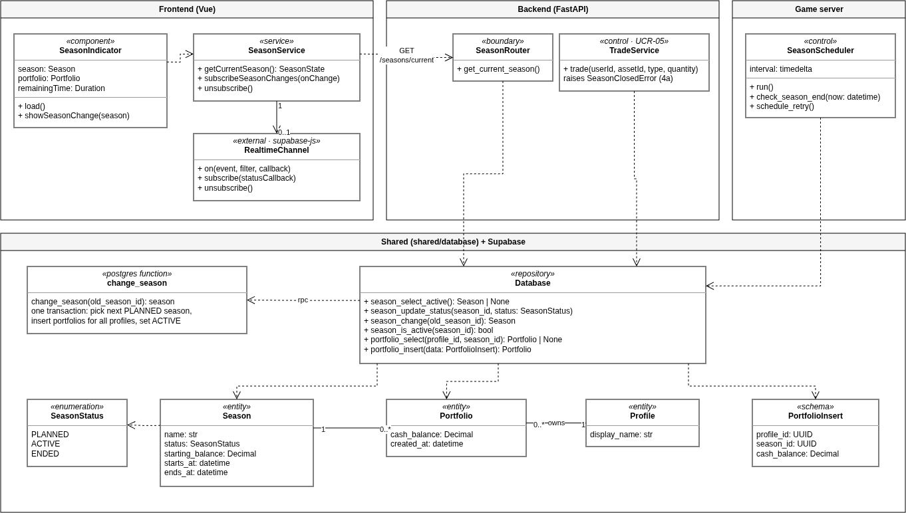
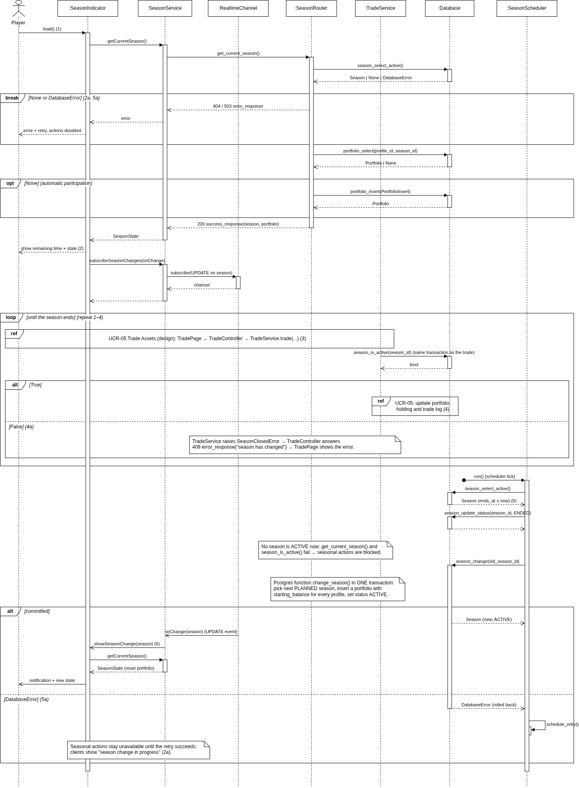

# UCR-04 Compete in Seasons — Use-Case Realization

| Author | Realizes                                                          |
|--------|-------------------------------------------------------------------|
| Max    | [UC-04 Compete in Seasons](../use_cases/UC-04_Compete_in_Seasons.md) |

## 1 Introduction

This document describes how [UC-04 Compete in Seasons](../use_cases/UC-04_Compete_in_Seasons.md) is realized: which
objects work together, and in which order, when a player sees the current season, plays in it, and is moved into the
next season when it ends. It covers the basic flow and the alternative flows 2a, 4a, and 5a. The seasonal activity
itself is the trade of [UCR-05 Trade Assets](UCR-05-Trade_Assets.md) and is only referenced here. Crowning the winners
and configuring seasons and themes are left out.

## 2 Flow of events — design

### 2.1 Participating objects

| Object            | Stereotype | Responsibility                                                                                         |
|-------------------|------------|--------------------------------------------------------------------------------------------------------|
| :SeasonView       | «boundary» | Shows the remaining time and the player's seasonal game state, errors, and the season-change notification |
| :CompeteInSeasons | «control»  | Determines the active season, gives the player a portfolio in it, and rejects actions on an ended season |
| :ChangeSeason     | «control»  | Ends the season at its end date, resets the seasonal game state of all players, and activates the next season |
| :Season           | «entity»   | A season with name, status, starting balance, start and end date                                      |
| :Portfolio        | «entity»   | A player's seasonal game state in one season: cash balance, holdings, and trades                      |
| :Profile          | «entity»   | A player; used to reset the state of every player                          |

### 2.2 Sequence diagrams

### 2.3 Walkthrough

When the player opens the application (step 1), `:SeasonView` asks `:CompeteInSeasons` for the season state. The
control reads the active `:Season`. If there is none, or it cannot be read, the `break` fragment shows an error with
the offer to retry, and seasonal actions stay unavailable (2a). This is also what a player sees while a season change
is still running (5a), because then no season is active. Otherwise the control loads the player's `:Portfolio` for this
season. The `opt` fragment creates it with the starting balance if the player has none yet, which is how participation
becomes automatic. The view shows the remaining time and the seasonal game state (step 2).

The `loop` covers steps 3 and 4. Before an activity changes anything, `:CompeteInSeasons` checks that its season is
still active. If so, the trade of UCR-05 updates the portfolio and the view shows the new state. If the season has
changed meanwhile, the action is rejected and does not touch the new season (4a).

Step 5 is not started by the player but by time: the found message `seasonEndReached` starts `:ChangeSeason` when the
end date is reached. It first ends the old season, so from now on all seasonal actions are rejected. Then it gets the
next planned season and all profiles. In the `alt [reset succeeded]` branch it creates a new portfolio with the starting
balance for every profile (NFR-U-04), activates the new season, and notifies the view,
which informs the player (step 6). If the reset fails (5a), everything is rolled back, players are told that the
season change is in progress, and the reset is retried.

### 2.4 State machine

`:Season` has a status with rules. Seasonal actions are only accepted while a season is `ACTIVE`.

### 2.5 Design classes

| Analysis object (2.1)       | Design class(es)                                                                                                                        |
|-----------------------------|-----------------------------------------------------------------------------------------------------------------------------------------|
| :SeasonView «boundary»      | SeasonIndicator                                                                           |
| :CompeteInSeasons «control» | SeasonService , SeasonRouter, TradeService (UCR-05, checks the season in its transaction) |
| :ChangeSeason «control»     | SeasonScheduler, Postgres function `change_season`, RealtimeChannel            |
| :Season «entity»            | Season, SeasonStatus                                                                                                                     |
| :Portfolio «entity»         | Portfolio, PortfolioInsert                                                                                                               |
| :Profile «entity»           | Profile                                                                                                                                  |
| (all entities)              | Database |

Both versions of the sequence diagram stay in the repo, so a reader can see how the analysis objects became design
classes: [UCR-04_sequence.drawio](../diagrams/UCR-04_sequence.drawio) (analysis) and
[UCR-04_sequence_design.drawio](../diagrams/UCR-04_sequence_design.drawio) (design).

## 3 Derived requirements

- DR-04-01 — Creating the portfolios of all players and activating the new season run in one database transaction
  (Postgres function `change_season`); if it fails, nothing of it is kept and the season change is retried.
- DR-04-02 — Every seasonal action checks in its own transaction that the season of the portfolio is `ACTIVE`, so an
  action started before the season change cannot modify the new season (4a).
- DR-04-03 — At most one season is `ACTIVE` at a time; the old season is set to `ENDED` before the reset starts, so
  no seasonal action runs against a partially reset state (5a).
- DR-04-04 — The season scheduler runs in the game server independently of connected players (NFR-U-04).
