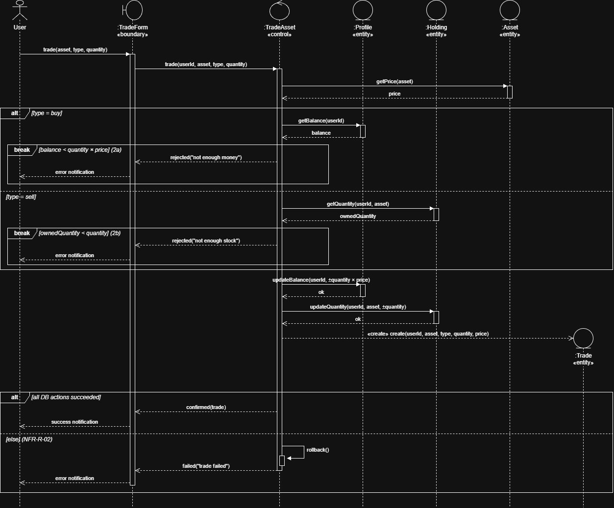
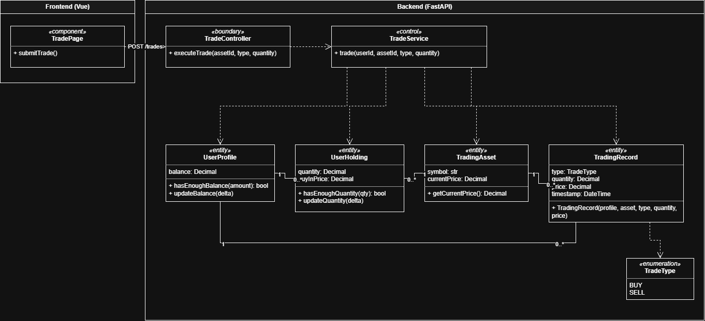
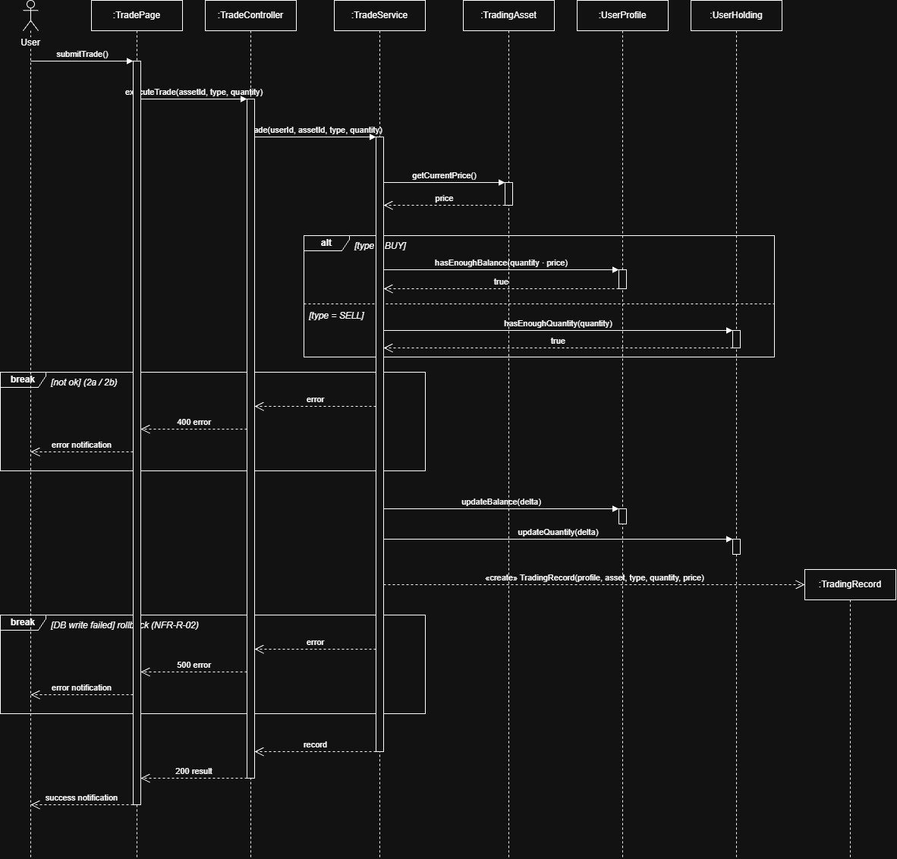

# UCR-05_Trade_Assets — Use-Case Realization

| Author | Realizes |
| ------ |----------|
| Justus | [UC-05-Trade_Assets](../use_cases/UC-05_Trade_Assets.md) |

## 1 Introduction

<!-- Two or three sentences: which use case this realizes, which of its flows it covers, and
     what is left out. Terms belong in the SRS, not here. -->

This document describes the realization of [UC-05 Trade Assets](../use_cases/UC-05_Trade_Assets.md).
It shows which analysis objects work together, and in which order, when a logged-in user buys or sells an asset
by choosing the trade type and quantity and confirming the trade. The alternative flows "not enough money" (2a)
and "not enough stock" (2b) are covered as fragments in the sequence diagram, as well as the rollback when a
database action fails (NFR-R-02).

## 2 Flow of events — design

### 2.1 Participating objects

<!-- Every object in your sequence diagrams, with one responsibility each.
     Boundary: between an actor and the system — one per actor and use case;
               an external system is reached through a boundary too.
     Control:  coordinates this use case — usually one.
     Entity:   information that must be stored. -->

| Object       | Stereotype | Responsibility                                                                                   |
|--------------|------------|--------------------------------------------------------------------------------------------------|
| :TradeForm   | «boundary» | Takes asset, trade type (buy/sell) and quantity from the user, shows a success or error notification |
| :TradeAsset  | «control»  | Checks balance or holdings, executes the trade in one transaction, rolls back if a step fails    |
| :Profile     | «entity»   | The user's profile with his cash balance                                                         |
| :Holding     | «entity»   | One asset the user owns, with its quantity and buy-in price                                      |
| :Asset       | «entity»   | A tradable asset with its current price                                                          |
| :Trade       | «entity»   | One entry in the trade log: who traded which asset, buy/sell, quantity, price and time           |

### 2.2 Sequence diagrams

### 2.3 Walkthrough

<!-- Walk through the diagrams in a few sentences: which object does what, in which order,
     and how the diagrams fit together. Refer to the steps of the use case (1, 2, 4a …). -->

After the user inputted all data in to the trade form.
The api gets the current price of the Asset.

When the type of the trade is buy we get the balance of the user and check if he has enough money.
if not we return an error

When the type is sell we get the current quantity of the user's holdings, if he does not have enough we return an error.

If there is no error we update the user's balance and quantity and create a trade for the trade log.

At last if all DB actions are successful we return a success notification.

else we roll everything back and return an error notification.

### 2.4 State machine

Not applicable

### 2.5 Design classes

| Analysis object (2.1) | Design class(es)            |
| --------------------- | --------------------------- |
| :TradeForm «boundary» | TradePage, TradeController  |
| :TradeAsset «control» | TradeService                |
| :Profile «entity»     | UserProfile                 |
| :Holding «entity»     | UserHolding                 |
| :Asset «entity»       | TradingAsset                |
| :Trade «entity»       | TradingRecord               |

## 3 Derived requirements

<!-- Requirements the design adds and the implementation must handle, each with an ID that is
     unique in the whole SRS, e.g.,
     DR-02-01 — The slot check and the insert of the booking run in one transaction.
     DR-02-02 — The e-mails are sent asynchronously; a failed send is retried three times.
     Write "None" if there are none. -->

- DR-05-01 — The DB is able to rollback the trade.
