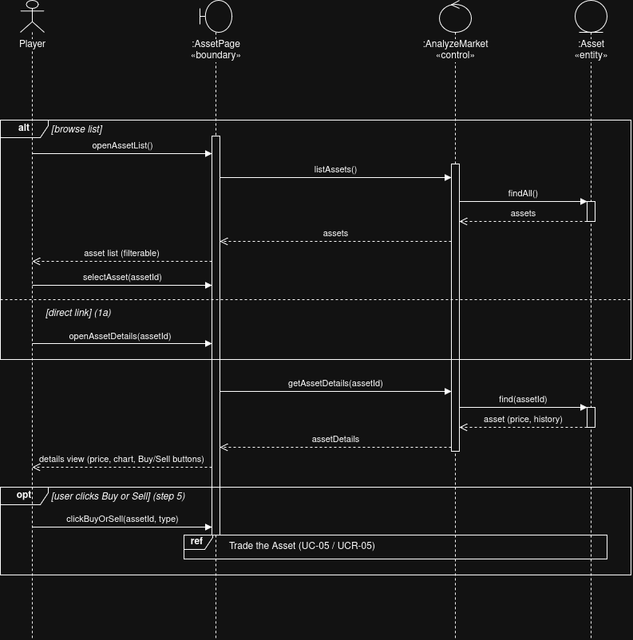
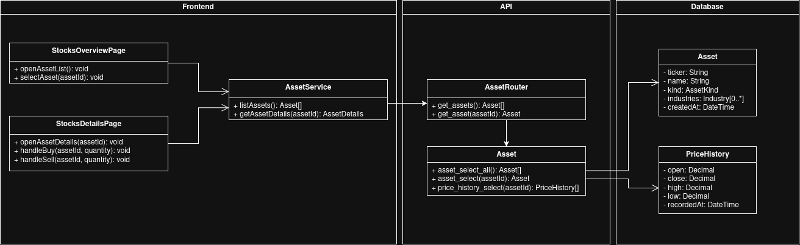
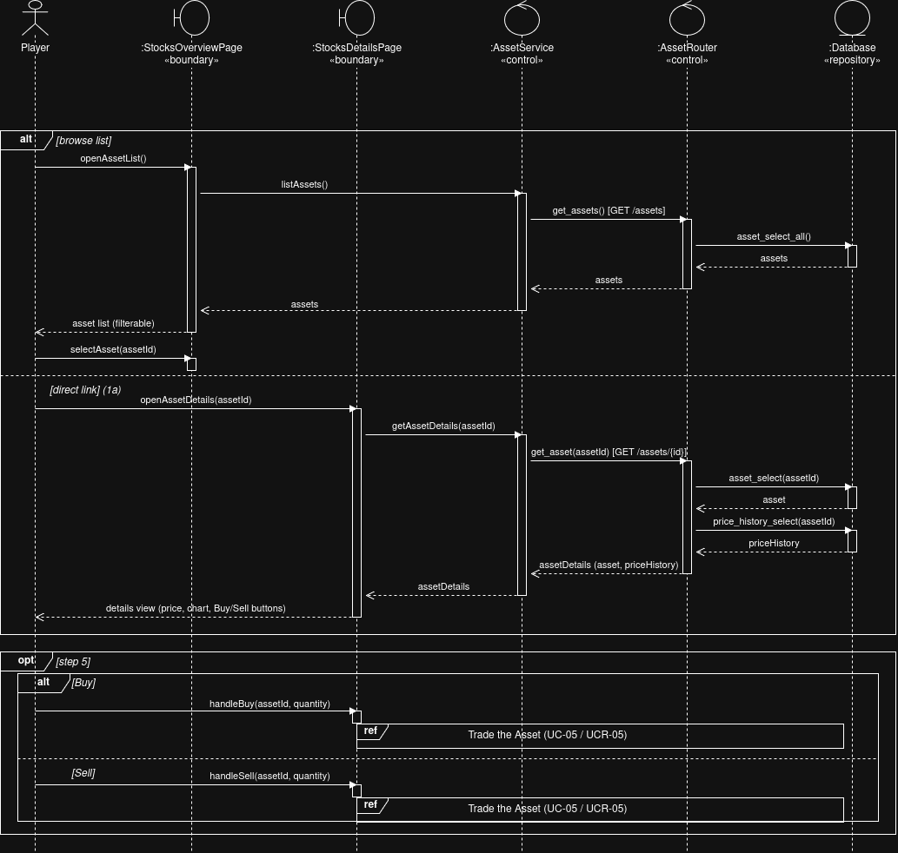

# UCR-06_Analyze_the_Market — Use-Case Realization

| Author    | Realizes                                                             |
|-----------|----------------------------------------------------------------------|
| Sebastian | [UC-06 Analyze the Market](../use_cases/UC-06_Analyze_the_Market.md) |

## 1 Introduction

This document describes how [UC-06 Analyze the Market](../use_cases/UC-06_Analyze_the_Market.md) is realized: it
walks through the objects that work together, and in which order, when a player browses the list of tradable
assets and opens the details of one of them. Both ways of reaching the details page are covered — browsing the
list first, and opening an asset's details page directly from elsewhere in the app (flow 1a). The optional
buy/sell action at step 5 is only sketched here as a reference; the trade itself is realized in
[UCR-05 Trade Assets](UCR-05-Trade_Assets.md).

## 2 Flow of events — design

### 2.1 Participating objects

| Object         | Stereotype | Responsibility                                                                   |
|----------------|------------|----------------------------------------------------------------------------------|
| :AssetPage     | «boundary» | Shows the filterable asset list and the asset details page with Buy/Sell buttons |
| :AnalyzeMarket | «control»  | Loads the asset list, or one asset with its current price and history            |
| :Asset         | «entity»   | A tradable asset with its current price and historical price series              |

### 2.2 Sequence diagrams

### 2.3 Walkthrough

The outer `alt` fragment captures the two ways a player can reach the details page. In the `[browse list]` branch,
the player opens the asset list (step 1); `:AnalyzeMarket` loads all assets, the page shows them in a filterable
list, and the player picks one (step 3). In the `[direct link]` branch (1a), the player opens an asset's details
page directly — for example from the portfolio — skipping the list entirely.

Either way, the flow converges on the same next step: `:AssetPage` asks `:AnalyzeMarket` for that one asset's
details, which in turn loads its current price and historical data from `:Asset` so the page can render them as
charts (step 4).

The trailing `opt` fragment covers step 5, which is optional because the player may just be browsing: if they
click Buy or Sell, the click itself is still handled by `:AssetPage`, but the trade that follows is out of scope
here and is realized in UC-05 `Trade the Asset` instead.

### 2.4 State machine

Not applicable

### 2.5 Design classes

| Analysis object (2.1) | Design class(es) |
| ---------------------- | ---------------- |
| [:AssetPage «boundary»] | [StocksOverviewPage, StocksDetailsPage] (Vue pages, `frontend/src/pages/`) |
| [:AnalyzeMarket «control»] | [AssetService] (frontend, `frontend/src/services/`) and [AssetRouter] (backend, `api/app/routers/`) |
| [:Asset «entity»] | [Asset, PriceHistory] (`shared/shared/database/models/fastapi/`) and [Database] (`shared/shared/database/repository.py`, extended with `asset_select_all`, `asset_select`, `price_history_select`) |

The analysis-level `:AnalyzeMarket` control splits across the stack once it becomes code: `AssetService` lives in
the browser and calls the `/assets` API, while `AssetRouter` receives that call on the backend and asks `Database`
to load the data. Neither class exists in the code yet, so the names above are the plan to implement for
[2TM-87](https://2themoon.youtrack.cloud/issue/2TM-87); the Buy/Sell buttons on `StocksDetailsPage` likewise become
two separate handlers, `handleBuy` and `handleSell`, each handing off to UC-05 the same way `:AssetPage` did at
the analysis level.

Both versions of the sequence diagram stay in the repo, so a reader can see how the analysis objects became
design classes: [UCR-06_sequence.drawio](../diagrams/UCR-06_sequence.drawio) (analysis) and
[UCR-06_sequence_design.drawio](../diagrams/UCR-06_sequence_design.drawio) (design).

## 3 Derived requirements

None
