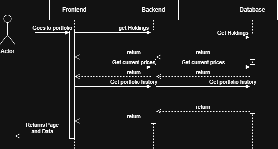

# UC-01-Analyze-Portfolio

| Author       | Estimate       | User stories                                                        |
|--------------|----------------|---------------------------------------------------------------------|
| Justus       | 20             | 2TM-57                                                              |

## 1 Brief description

The user wants to look at his portfolio and check the perfomance of his trades.
Furthermore the stocks that this user holds will be displayed with the option to sell.

## 2 Actors

- **Primary:** User
- **Secondary:** System

## 3 Mockup

## 4 Flow of events

### 4.1 Basic flow

1. The user opens the portfolio page.
2. The System loads the investor's holdings and current prices and displays each stock with its quantity, current value and performance.
3. The System displays the holdings with the current prices
### 4.2 Alternative flows

**2a · No Holdings .** At step 2, user has no holdings. The system displays everything with "0" placeholders and skeletons. The use case ends.

**2b · Price data unavailable.** At step 2, current prices cannot be retrieved. The system shows the last known prices with a warning.

### 4.3 Sequence diagram

## 5 Special requirements

Not applicable

## 6 Preconditions

- User is Logged in

## 7 Postconditions

Not applicable
