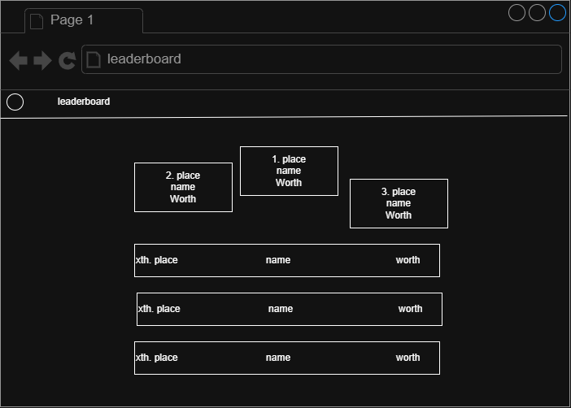
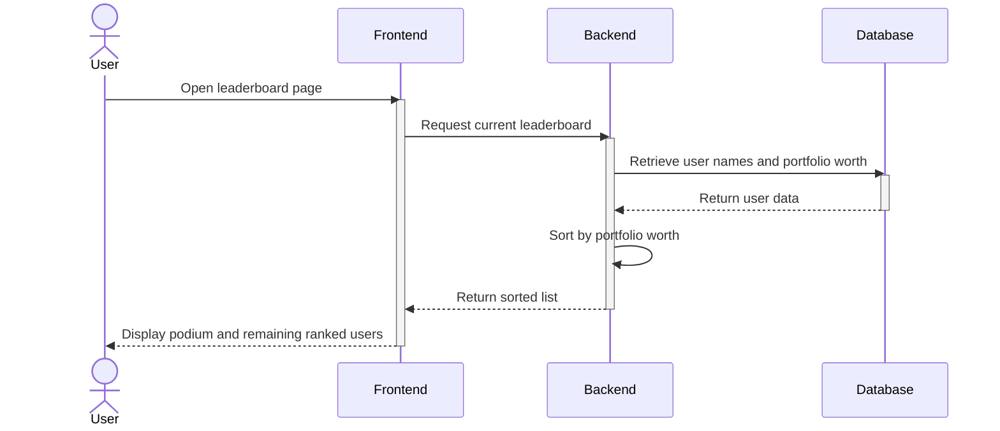
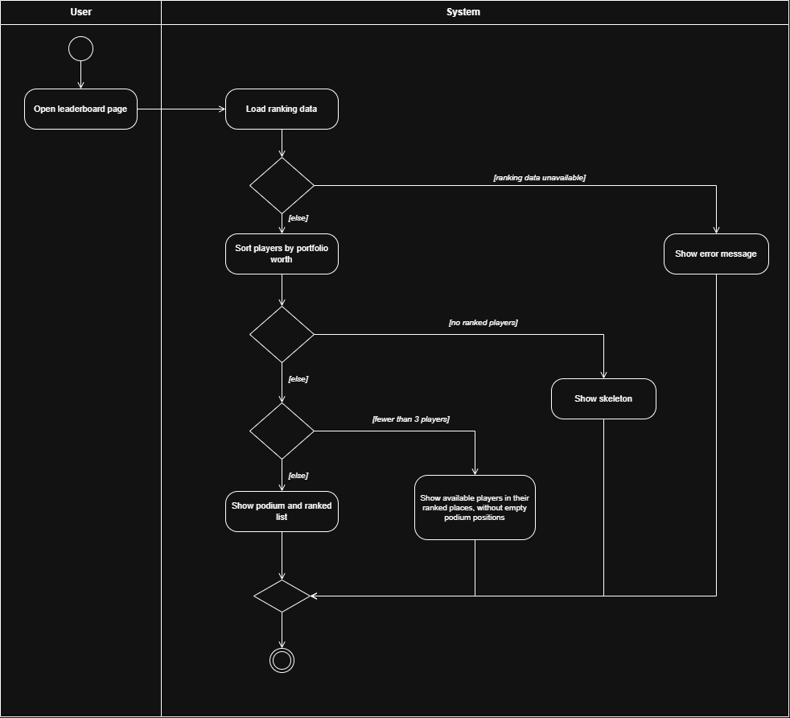

# UC-02 Compare Player Performance

| Author | Estimate | User storie                          |
|--------|----------|--------------------------------------|
| Mika   | 13       | 2TM-81 Compare Portfolio Performance |

## 1 Brief description

The player views the leaderboard to compare their portfolio worth with that of other players. The system ranks players
by portfolio worth and displays each player's place, name, and worth.

## 2 Actors

- **Primary:** Player
- **Secondary:** None.

## 3 Mockup

## 4 Flow of events

### 4.1 Basic flow

1. The user opens the leaderboard page.
2. The system displays the podium and ranked list of players.
3. The user views the podium and ranked list.

### 4.2 Alternative flows

**2a · No ranked users.** At step 2, the database has no players to fill the leaderboard with. The system displays a
skeleton. The use case ends.

**2b · Fewer than three users.** At step 2, fewer than three leaderboard entries are available. The system displays the
available users in their ranked places and shows no empty podium positions.

**2c · Ranking data unavailable.** At step 2, the backend cannot retrieve the ranking data. The frontend displays an
error message instead of the leaderboard. The use case ends.

### 4.3 Sequence diagram

## 4.4 Activity diagram

## 5 Special requirements

None.

## 6 Preconditions

- Player is logged in

## 7 Postconditions

- The leaderboard, a skeleton, or an error message is displayed
- No data is changed
