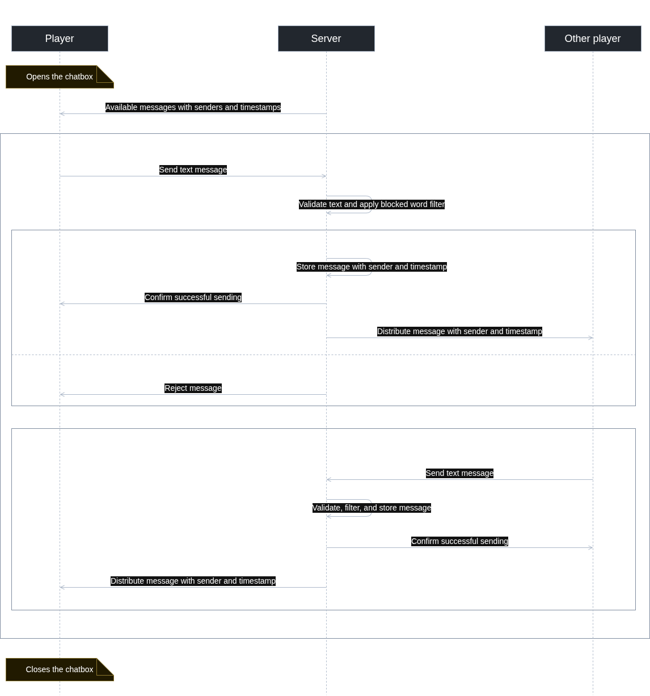

# UC-03 Use global Chat

<!--
HOW TO USE THIS TEMPLATE
- Copy this file per use case and name it UC-01_[name].md, UC-02_[name].md, …
- Replace every [placeholder] in square brackets.
- Name: verb plus object, one goal reached in one sitting ("Book a room", not "Click Save").
- Describe what the actor and the system exchange, not which button is clicked —
  the mockup shows the screen.
- Delete these comments once the use case is done.
- Structure after the RUP template "Use-Case Specification":
  https://cin.ufpe.br/~if682/RUP/webtmpl/templates/req/rup_ucspec.htm
-->

| Author | Estimate | User stories |
| ------ | -------- | ------------ |
| Max | 13 | **2TM-67** Send filtered messages in the global chat, **2TM-73** Access and read the global chat|

## 1 Brief description

A player exchanges text messages with other players in the global chat. The system displays available messages, accepts new messages, and displays incoming messages. This allows players to communicate during the game.

## 2 Actors

- **Primary:** Player
- **Secondary:** Other Players

## 3 Mockup

## 4 Flow of events

### 4.1 Basic flow

<!-- The success case, 3 to 9 numbered steps (Cockburn). Actor and system take turns. -->

1. The Player opens the chat.
2. The system displays all available message with timestamp and sender.
3. The Player sends a text message.
4. The system validates the message.
5. The system stores the message with timestamp and sender
6. Other palyers send messages.
7. The system displays incoming messages with timestamp and sender
Repeat 3-7
8. The player leaves the chat.

### 4.2 Alternative flows

<!-- Name the step where each flow branches off and where it continues or ends.
     Errors, cancellations, and conflicts between users belong here.
     If your diagram shows another use case extending this one («extend»), name the step
     where it can start: "Extension point: …". If this use case always uses another one
     («include»), write it into the step: "(includes UC-07)". -->

**2a · Chat cannot be loaded.** At step 2, the system cannot retrieve messages. It informs the player and offers another attempt. If the player retries, the flow continues at step 1. Otherwise, the use case ends.

**3a · Leave without sending.** At step 3, the player leaves without submitting a message. The use case ends.

**4a · Empty message.** At step 4, the submitted text is empty or contains only whitespace. The system rejects it and explains that the message must contain text. The flow continues at step 3.

**5a · Storage failure.** At step 5, storage fails and the message is not committed. The system reports that sending failed and preserves the message text. No message is published. The flow continues at step 3.

**7a · Incoming connection interrupted.** At step 7, the system cannot receive updates. It indicates that the conversation may be out of date. After reconnection, it retrieves missed messages and continues at step 7. The player may leave at step 8.

### 4.3 Sequence diagram

<!-- The flow above over time: the actor, your frontend, your backend, your database.
     Show an alternative flow as an alt fragment where it matters.
     Commit the source file (PlantUML, draw.io, …) next to the image. -->

## 5 Special requirements

<!-- Quality requirements for this use case only, each with an ID that is unique in the
     whole SRS, e.g.,
     NFR-P-02 — The confirmation shall appear within 1 s for 95 % of the bookings.
     System-wide ones go into SRS sections 3.2 to 3.5. Write "None" if there are none. -->

 **SR-CHAT-01 — Message filtering:** The server shall check every submitted message against a configured list of blocked words before storing or distributing it. Matching shall be case-insensitive and based on whole words. Messages containing at least one blocked word shall be rejected, and the sender shall be informed.

## 6 Preconditions

<!-- The state of the system before the use case can start, e.g., "The user is logged in." -->

- Player is logged in
- Player is allowed to use the chat

## 7 Postconditions

<!-- The state of the system after the use case, e.g., "The booking is stored." -->

- Accepted messages are stored with sender andtimestamps.
- Accepted messages are available to participants in the global chat.
- Confirmed messages are shown as successfully sent to their senders.
