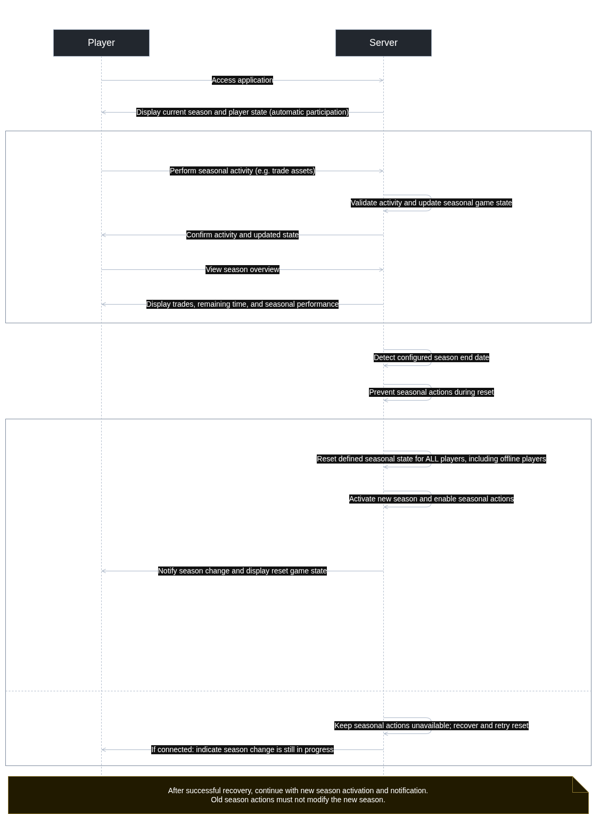

# UC-04 Compete in Seasons

<!--
HOW TO USE THIS TEMPLATE
- Copy this file per use case and name it UC-01_[name].md, UC-02_[name].md, …
- Replace every [placeholder] in square brackets.
- Name: verb plus object, one goal reached in one sitting ("Book a room", not "Click Save").
- Describe what the actor and the system exchange, not which button is clicked —
  the mockup shows the screen.
- Delete these comments once the use case is done.
- Structure after the RUP template "Use-Case Specification":
  https://cin.ufpe.br/~if682/RUP/webtmpl/templates/req/rup_ucspec.htm
-->

| Author | Estimate | User stories                                                                 |
|--------|----------|------------------------------------------------------------------------------|
| Max    | 13 + 8   | **2TM-79** Review the current season, **2TM-80** Start fresh in a new season |

## 1 Brief description

The game runs in seasons after which the winners are crowned, progress is wiped, and all players start anew in a new market. Each season may carry a theme and change the stocks on offer and money in circulation. At the beginning of each season, all players start with the same balance and otherwise empty portfolios.

## 2 Actors

- **Primary:** Player
- **Secondary:** Other Players

## 3 Mockup

## 4 Flow of events

### 4.1 Basic flow

<!-- The success case, 3 to 9 numbered steps (Cockburn). Actor and system take turns. -->

1. The player accesses the application.
2. The system displays the remaining time in the season and the player’s seasonal game state. Participation is
   automatic.
3. The player performs activities that contribute to seasonal performance, such as trading assets.
4. The system updates the player’s seasonal game state.
   Repeat 1-4
5. At the configured season end date the system resets the defined seasonal game state for all players and activates the
   new season with the configured starting conditions.
6. The system informs the player of the season change and displays the new seasonal game state.

### 4.2 Alternative flows

<!-- Name the step where each flow branches off and where it continues or ends.
     Errors, cancellations, and conflicts between users belong here.
     If your diagram shows another use case extending this one («extend»), name the step
     where it can start: "Extension point: …". If this use case always uses another one
     («include»), write it into the step: "(includes UC-07)". -->

**2a · Season information unavailable.** At step 2, the system cannot retrieve the current season. It informs the player
and offers another attempt. Seasonal actions remain unavailable until the current season can be determined. If the
player retries, the flow continues at step 1.

**4a · Season changes during an action.** At step 4, the season changes before the action is committed. The system
rejects the outdated action and informs the player. The action does not affect the new season. The flow continues at
step 8.

**5a · Reset failure.** At step 5, the reset cannot be completed. The system informs players that the season change is
still in progress and prevents seasonal actions against a partially reset state. The flow continues at step 86after
successful recovery.

**5a · Storage failure.** At step 5, storage fails and the message is not committed. The system reports that sending
failed and preserves the message text. No message is published. The flow continues at step 3.

### 4.3 Sequence diagram

<!-- The flow above over time: the actor, your frontend, your backend, your database.
     Show an alternative flow as an alt fragment where it matters.
     Commit the source file (PlantUML, draw.io, …) next to the image. -->

## 5 Special requirements

<!-- Quality requirements for this use case only, each with an ID that is unique in the
     whole SRS, e.g.,
     NFR-P-02 — The confirmation shall appear within 1 s for 95 % of the bookings.
     System-wide ones go into SRS sections 3.2 to 3.5. Write "None" if there are none. -->

**NFR-U-04 — Consistent reset::** Before gameplay in a new season is enabled, the system shall reset the defined
seasonal game state for every player, including offline players, to the same configured starting conditions.

## 6 Preconditions

<!-- The state of the system before the use case can start, e.g., "The user is logged in." -->

- Player is logged in
- The current season, season end, and starting conditions are configured.
- The data included in the seasonal reset is defined.

## 7 Postconditions

<!-- The state of the system after the use case, e.g., "The booking is stored." -->

- The player participates automatically in the current season.
- Accepted activities are reflected in the current seasonal game state.
- After a successful season change, every player’s defined seasonal game state is reset.
- Actions from the previous season cannot modify the new season.
- If the reset fails, gameplay against a partially reset state remains unavailable.
