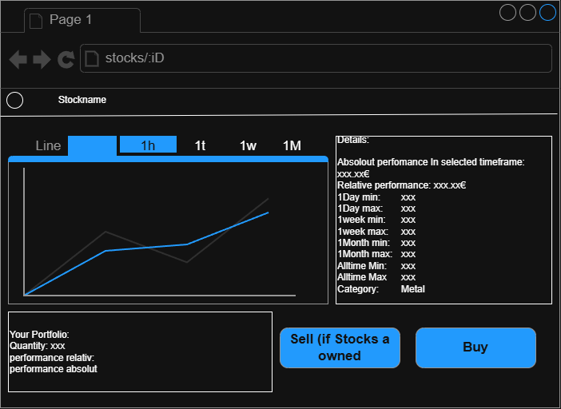
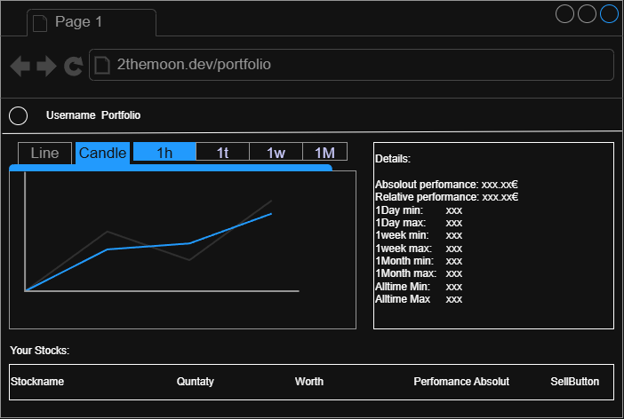

# UC-05-Trade-Assets

| Author | Estimate | User stories  |
|--------|----------|---------------|
| Justus | 20 + 20  | 2tm-84,2tm-85 |

## 1 Brief description

The user wants to trade his assets.

## 2 Actors

- **Primary:** User
- **Secondary:** Backend (API)

## 3 Mockup

## 4 Flow of events

### 4.1 Basic flow

1. The user decides to buy/sell and user selects the quantity
2. The Systems check on buy if the user has enough money, on sell enough stock
3. The action goes through. The User gets Feedback with an Notification

### 4.2 Alternative flows

**2a · Not enough money.** At step 2 and buy selected . The system notifies the user. The use case ends. **2b · Not
enough stock.** At step 2 an sell selected, . The system notifies the user. The use case ends.

### 4.3 Sequence diagram

![Sequence diagram UC-[05]](../diagrams/UC-05-sequence.png)

## 5 Special requirements

Not applicable

[…]

## 6 Preconditions

- User logged in

## 7 Postconditions

- System saves the trade in the trade log
- System updates the asset tables
- System updates the users current holdings
