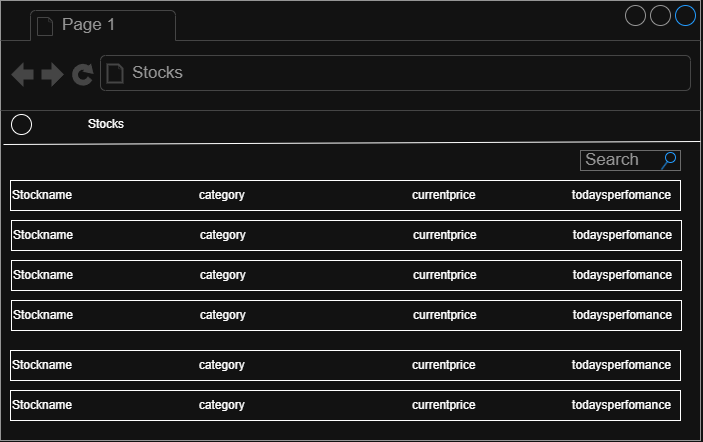
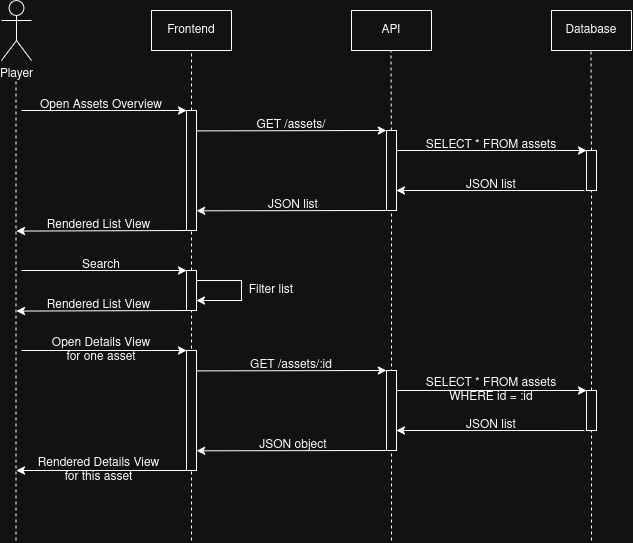

# UC-06 Analyze the Market

| Author    | Estimate | User stories                                                                              |
|-----------|----------|-------------------------------------------------------------------------------------------|
| Justus    | 20       | [2TM-17 Build Stock Detail Page](https://2themoon.youtrack.cloud/issue/2TM-17)            |
| Max       | 20       | [2TM-41 Browse available stocks and crypto](https://2themoon.youtrack.cloud/issue/2TM-41) |
| Sebastian | 13       | [2TM-87 API Endpoint /assets](https://2themoon.youtrack.cloud/issue/2TM-87)               |

## 1 Brief description

The player can see a list of all available stock and crypto for trade. They can analyze their performance through
key numbers, line diagrams and candle charts. This enables the player to make informed investment decisions.

## 2 Actors

- **Primary:** User
- **Secondary:** None

## 3 Mockup

## 4 Flow of events

### 4.1 Basic flow

1. The user wants to see all available assets and opens the asset list page.
2. The system displays a filterable list with basic associated information.
3. The user filters and selects one asset to see details of.
4. The system switches to a details page of this asset, showing current prices as well as historical data displayed as
   charts.
5. Based on this information, the user can make an informed buy/sell/hold decision, and possibly immediately execute on
   this decision through Buy + Sell buttons on this page.

### 4.2 Alternative flows

**1a · Open stock details directly.** At step 1, the user can open the details page of one stock directly. The system
might link these pages directly from other dashboards or the portfolio page that lists the user's held assets.
The flow continues at step 4.

### 4.3 Sequence diagram

## 5 Special requirements

**NFR-P-03** – The list of stocks shall load in less than three seconds. **NFR-P-04** – The list of stocks shall be
filterable and sortable in less than one second.

## 6 Preconditions

- The user is logged in

## 7 Postconditions

None. This use case is idempotent. No information is being changed in [this flow](#4-flow-of-events).